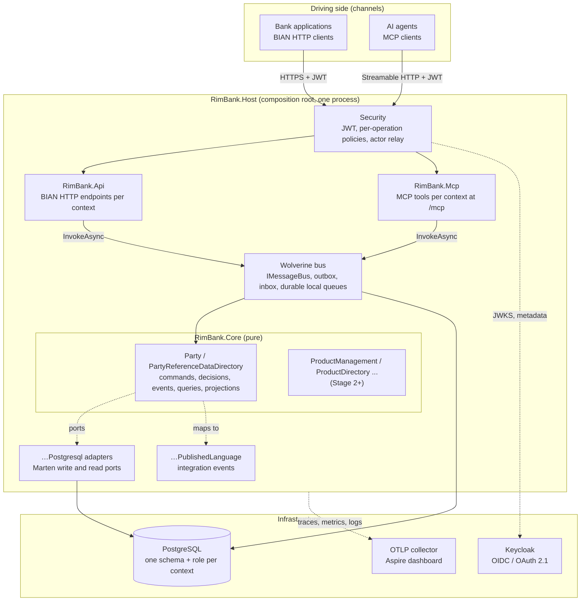

# 01. Architecture overview

> Status: describes `main` at the end of **Stage 1** (Party Reference Data Directory, roadmap 0.1–1.21), before Stage 2 (Product Directory).
> Normative sources: [mission](../../specs/mission.md), [tech stack](../../specs/tech-stack.md), [roadmap](../../specs/roadmap.md) and the [ADRs](../adr/). When this document and those disagree, they win and this document has a bug.

## 1. Purpose and scope

RimBank is an open-source core banking platform that turns the **BIAN Service Landscape v14 (ISO 20022 extended, DDD edition)** into running software. This architecture set explains *how* it is built, at the level an enterprise architect, a solution architect or a new contributor needs to reason about it, change it, or plug it into a bank.

| Document | Question it answers |
|---|---|
| [01 Overview](01-architecture-overview.md) (this) | What are the drivers, principles, styles and building blocks? |
| [02 C4 model](02-c4-model.md) | What are the system's context, containers, components and code structure? |
| [03 Data model and ERD](03-data-model-erd.md) | What is stored, in which schema, with which keys and relationships? |
| [04 Sequence diagrams](04-sequence-diagrams.md) | What happens, step by step, for each operation and failure path? |
| [05 Logic flows and state machines](05-logic-flows.md) | How does each decision branch, and which lifecycle states exist? |
| [06 Data flow](06-data-flow.md) | Where does data enter, move, rest and leave; which of it is PII? |
| [07 Dependencies](07-dependencies.md) | Which project may depend on which, and how do contexts integrate? |
| [08 Deployment, security and operations](08-deployment-security-operations.md) | How does it run, how is it protected and observed? |
| [09 Quality attributes, risks and roadmap](09-quality-risks-roadmap.md) | Which qualities are guaranteed, by what evidence, and what is still open? |

The business view (BIAN positioning, entity dictionary, relationships, value streams and use cases) is in [../business/](../business/README.md).

## 2. Architecture drivers

### 2.1 Business drivers

| Driver | Consequence for the architecture |
|---|---|
| BIAN describes *what* a bank does, not *how* to build it | Each BIAN service domain is a bounded context; BIAN names are the code's names; BIAN YAMLs are tested against the code (conformance tests) |
| Core banking must be auditable | Event sourcing: state is derived from business events, every change has an actor, time, correlation id |
| Banks consume capabilities from many channels, including AI agents | Two driving adapters over one core: BIAN HTTP API and MCP tools, with proven parity |
| Adopters must be able to take one capability without the rest | Autonomous contexts, integration by published events only, modular monolith that can be split |

### 2.2 Quality attribute priorities

Ordered: when two collide, the higher one wins.

1. **Correctness and integrity** (money is never created or lost; invariants checked on authoritative write-side state)
2. **Security and privacy** (authenticated by default, per-operation authorisation, PII protected)
3. **Auditability** (append-only event streams, actor and trace on every change)
4. **Evolvability** (contexts isolated by namespace, schema and database role; extraction changes no core code)
5. **Interoperability** (BIAN routes, ISO 20022 data types, RFC 9457 errors, MCP)
6. **Operability** (OpenTelemetry, health probes, rebuildable read models)
7. **Performance** (measured in Stage 7; CQRS allows physical separation later)

### 2.3 Constraints

- .NET 10 / C# 14, PostgreSQL, Marten, Wolverine, ASP.NET Core Minimal APIs, MCP C# SDK, Keycloak (OIDC), .NET Aspire ([tech-stack §1](../../specs/tech-stack.md#1-platform)).
- `TreatWarningsAsErrors`, central package management, locked restore, nuget.org only ([ADR 0013](../adr/0013-warning-and-package-governance.md)).
- MIT licence; RimBank is not a licensed bank and provides no regulatory certification.

## 3. Architecture styles

| Style | Where | Decision |
|---|---|---|
| **Domain-Driven Design** (strategic + tactical) | One BIAN service domain = one bounded context; Control Record = aggregate root; Behavior Qualifier = entity (or own aggregate by ADR) | [mission](../../specs/mission.md), [ADR 0024](../adr/0024-party-reference-data-directory-mapping.md) |
| **Hexagonal (ports and adapters)** | Core depends on nothing technical; adapters (`.Api`, `.Mcp`, `.Postgresql`, `.Subscriptions`) depend on the core | [tech-stack §4](../../specs/tech-stack.md#4-dependency-rules-enforced-by-architecture-tests) |
| **Functional core** | `Decide(command, state) → Result<events>`, `Evolve(state, event) → state`, `Project(view, event) → view` are pure | [ADR 0010](../adr/0010-decider-and-projection-contracts.md) |
| **Event sourcing** | Aggregates persisted as Marten event streams | [ADR 0016](../adr/0016-per-context-marten-stores.md) |
| **CQRS** | Commands → write port → aggregate; queries → read port → views; enforced by architecture tests | [ADR 0003](../adr/0003-separate-commands-and-queries.md), [ADR 0012](../adr/0012-cqrs-role-markers.md) |
| **Event-driven integration** | Contexts communicate through versioned integration events via the transactional outbox | [ADR 0004](../adr/0004-loosely-coupled-contexts.md), [ADR 0036](../adr/0036-party-published-language.md) |
| **Modular monolith** | One deployable host composes all contexts; each context is extractable | [ADR 0014](../adr/0014-host-composition-and-module-entry-point.md), [ADR 0023](../adr/0023-one-core-project.md), [ADR 0025](../adr/0025-one-api-project.md) |

## 4. Building blocks at a glance

## 5. Key architectural decisions (summary)

| # | Decision | Why | ADR |
|---|---|---|---|
| 1 | Event-sourced aggregates with pure deciders | Audit trail by construction; decisions unit-testable without I/O | [0010](../adr/0010-decider-and-projection-contracts.md) |
| 2 | Logical CQRS everywhere, physical only where needed | Avoid premature read stores; keep read-your-write for Control Records (inline views) | [0003](../adr/0003-separate-commands-and-queries.md) |
| 3 | One Marten store, schema and DB role per context | Isolation enforced by the database, not only by convention | [0016](../adr/0016-per-context-marten-stores.md) |
| 4 | One `RimBank.Core`, one `RimBank.Api`, one `RimBank.Mcp` project, folders per context | Fewer projects; isolation by namespace rules in architecture tests | [0023](../adr/0023-one-core-project.md), [0025](../adr/0025-one-api-project.md), [0026](../adr/0026-flat-context-namespaces.md) |
| 5 | `Result`/`Error` for business failures, RFC 9457 at every edge | Uniform errors on HTTP and MCP from one mapping | [0006](../adr/0006-result-and-error-model.md), [0015](../adr/0015-problem-details-mapping.md) |
| 6 | Idempotency key on every command, stored with the events | Exactly-once business effect on retries | [0018](../adr/0018-idempotency-keys-for-commands.md) |
| 7 | Optimistic concurrency via stream version (`ETag` / `If-Match`) | Lost updates impossible; one automatic retry of a lost race | [0027](../adr/0027-optimistic-concurrency-for-commands.md) |
| 8 | Per-operation authorisation policies (read/write scopes per context) | Least privilege per BIAN operation, same on HTTP and MCP | [0038](../adr/0038-per-operation-authorisation-policies.md) |
| 9 | MCP as a first-class driving adapter | AI agents get the same rules, audit and errors | [0021](../adr/0021-mcp-wiring-and-tool-conventions.md), [0039](../adr/0039-party-mcp-tools.md), [0040](../adr/0040-party-mcp-command-tools.md) |
| 10 | Associations BQ as its own aggregate; other BQs as entities of the entry | Associations have their own lifecycle and many instances per party | [0024](../adr/0024-party-reference-data-directory-mapping.md), [0033](../adr/0033-party-associations.md) |
| 11 | Published language mapped from domain events, never read models | Producers can change their internal model freely | [0036](../adr/0036-party-published-language.md) |
| 12 | Conformance tests against the BIAN YAMLs | The API cannot silently drift from BIAN | [0020](../adr/0020-bian-conformance-harness.md), [0037](../adr/0037-bian-body-and-payload-conformance.md) |

## 6. BIAN → architecture mapping

| BIAN concept | Architecture element | Party example |
|---|---|---|
| Business Area / Business Domain | First namespace segment | `RimBank.Party` |
| Service Domain | Bounded context: core folder + adapters + schema + role + scopes | `RimBank.Party.PartyReferenceDataDirectory`, schema `party_reference_data_directory` |
| Control Record | Event-sourced aggregate root | `PartyReferenceDataDirectoryEntry` |
| Behavior Qualifier | Entity in the aggregate, or own aggregate by ADR | Demographics, Reference, BankRelations (entities); Associations (`PartyAssociation` aggregate) |
| Action term (Register, Update, Exchange, …) | Command + pure decision + domain events | `RegisterParty` → `PartyRegistered` |
| Retrieve | Query over an inline view | `RetrievePartyReferenceDataDirectoryEntry` |
| AsyncAPI channel | Integration event in `.PublishedLanguage` | `PartyReferenceDataDirectoryEntry/Created` |
| ISO 20022 data type | Value object with the type's constraints | `Max35Text` → `TaxIdentificationNumber` |

## 7. Glossary of architecture terms

| Term | Meaning in RimBank |
|---|---|
| Acknowledgement | A command's success result, built from the decided state and stream version, never from a read model |
| Decider | Aggregate state type implementing `IDecider` with static `Decide` and `Evolve` |
| Inline view | Read model updated in the same transaction as the events (read-your-write) |
| Async view | Read model updated by Marten's async daemon (eventually consistent) |
| Published language | A context's integration events: its only public contract besides its APIs |
| Write port / read port | Core interfaces (`IWritePort` / `IReadPort`) implemented by `.Postgresql` |
| Stream version | Number of events in an aggregate's stream; exposed as `ETag`, checked by `If-Match` |
| Operation id | BIAN operation name (`Demographics/Update`), also the authorisation policy name |
