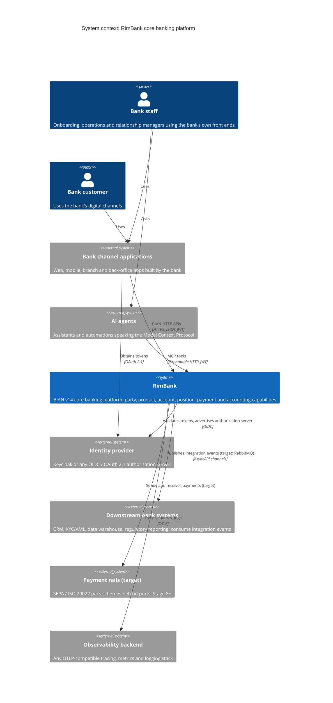
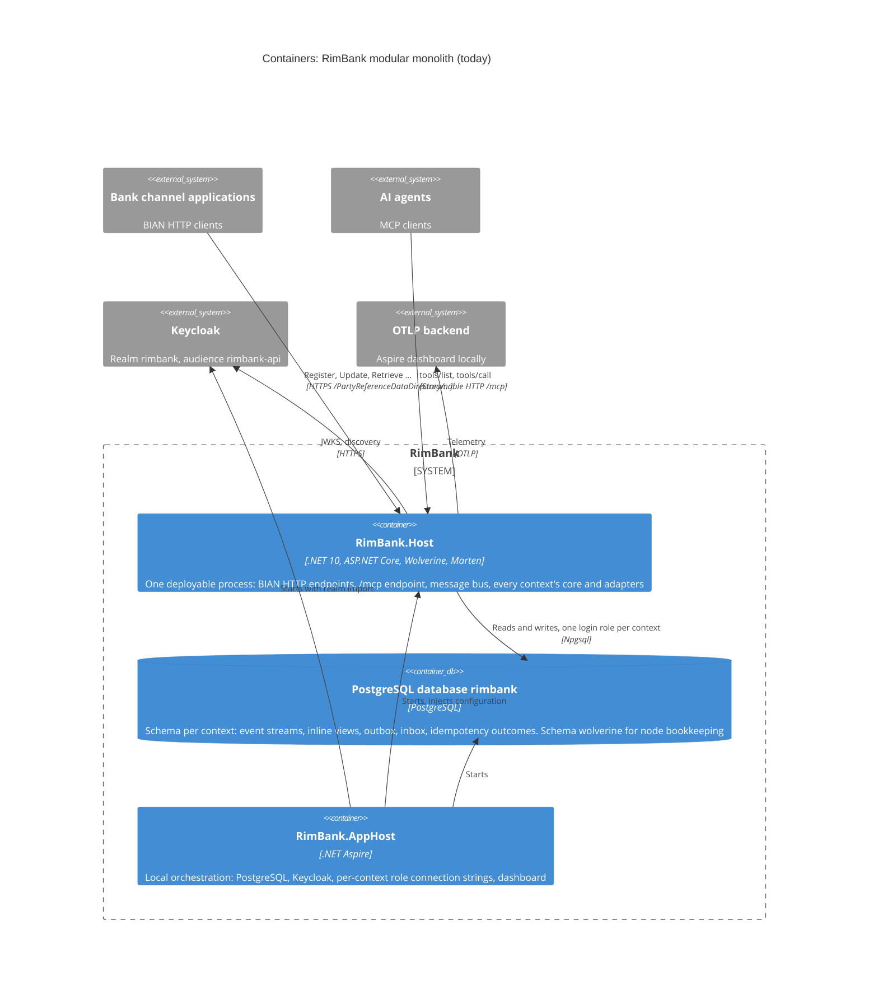
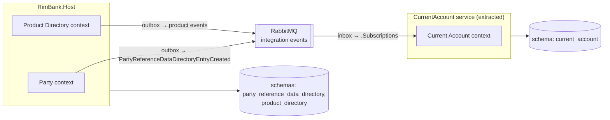
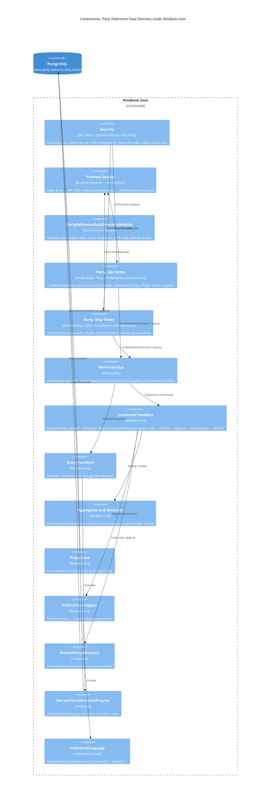

# 02. C4 model

The [C4 model](https://c4model.com) at four levels. Diagrams marked *(target)* include contexts from the roadmap that do not exist yet; all others describe `main` today.

## Level 1: System context

Who uses RimBank and what it relies on.

**Key point:** RimBank has no end-user UI ([mission non-goals](../../specs/mission.md#non-goals)). Every human reaches it through a bank-built channel or an AI agent. Both channel types are equal citizens: same core, same policies, same errors.

## Level 2: Containers

| Container | Responsibility | Technology | Scales by |
|---|---|---|---|
| `RimBank.Host` | All request handling, decisions, persistence, messaging | ASP.NET Core Minimal APIs, MCP C# SDK, Wolverine, Marten | Horizontal instances; Wolverine `DurabilityMode.Balanced` shares durable work across nodes |
| PostgreSQL | System of record: events, views, outbox/inbox, idempotency | PostgreSQL | Vertical first; read replicas or dedicated read stores only by ADR (roadmap 7.6) |
| Keycloak | Tokens, scopes, MCP authorization server | Keycloak (dev); any OIDC provider elsewhere | External |
| `RimBank.AppHost` | Developer and test orchestration | .NET Aspire | Not deployed to production |

### Container view after extraction *(target)*

The modular-monolith promise ([tech-stack §2](../../specs/tech-stack.md#2-topology-modular-monolith-first)): extracting a context moves its core folder and adapters into a new service and swaps the local durable queue for RabbitMQ. No core code changes.

## Level 3: Components of `RimBank.Host` for the Party context

### Component catalogue

| Component | Project / folder | Role (hexagonal) | Key types |
|---|---|---|---|
| Security | `RimBank.Host/Security` | Infrastructure (edge) | `AuthenticationComposition`, `OperationPolicies`, `OperationScopeRequirement`, `ActorRelay` |
| Module | `RimBank.Host/Modules/Party` | Composition | `PartyReferenceDataDirectoryModule` (scopes `party-reference-data-directory:read` / `:write`) |
| HTTP adapter | `RimBank.Api/Party/PartyReferenceDataDirectory/*` | Driving adapter | `RegisterPartyEndpoint`, `Update…Endpoint`, `Retrieve…Endpoint`, request/response records |
| HTTP conventions | `RimBank.Api` (root) | Driving adapter support | `IdempotencyKeyHeader`, `RequireIdempotencyKey()`, ETag / If-Match helpers |
| MCP adapter | `RimBank.Mcp/Party/PartyReferenceDataDirectory/*` | Driving adapter | 13 tools `party_reference_data_directory_*` |
| MCP conventions | `RimBank.Mcp` (root) | Driving adapter support | `ToToolResult`, tool error filter, authorisation filter, `[ToolOperation]` |
| Error mapping | `RimBank.Problems` | Shared edge | `Error` → Problem Details (`type`, `errorCode`, `traceId`, `errors`) |
| Core | `RimBank.Core/Party/PartyReferenceDataDirectory` | Domain + application | aggregates, commands, queries, handlers, views, projections, ports, publication |
| Persistence | `src/Party/…Postgresql` | Driven adapter | `MartenPartyDirectory`, `MartenPartyDirectoryEnquiry`, `PartyReferenceDataDirectoryPostgresql.Configure` |
| Persistence conventions | `RimBank.Postgresql` | Driven adapter support | `AddServiceDomainStore`, `IdempotencyGate`, `CommandConcurrencyRetryPolicy`, `AddInlineView` |
| Published language | `src/Party/…PublishedLanguage` | Contract | `PartyReferenceDataDirectoryEntryCreated`, `…Updated` |
| Shared kernel | `RimBank.SharedKernel` | Domain primitives | `Result`, `Error`, `ITypedId`, `Money`, `Currency`, `CountryCode`, `IDecider`, `IProjection`, `ICommand`, `IQuery`, `Actor` |

## Level 4: Code (domain model of the Party core)

```mermaid
classDiagram
    direction LR

    class IDecider~TState,TCommand,TEvent~ {
        <<interface>>
        +Decide(command, state) Result~events~
        +Evolve(state, event) state
    }

    class PartyReferenceDataDirectoryEntry {
        <<aggregate root / Control Record>>
        +PartyReferenceDataDirectoryEntryId? Id
        +PartyType? PartyType
        +DateTimeOffset? OpenDate
        +DateTimeOffset? RefreshDate
        +DemographicsId? DemographicsId
        +PartyReferenceId? PartyReferenceId
        +BankRelationsId? BankRelationsId
        +DemographicsRecord? Demographics
        +PartyReferenceDetails? Reference
        +BankRelationsDetails? BankRelations
        +Decide()$
        +Evolve()$
    }

    class DemographicsRecord {
        <<entity: Demographics BQ>>
        +PartyDemographics Details
        +DemographicsVerificationStatus VerificationStatus
        +DateTimeOffset? VerificationDate
    }
    class PartyDemographics {
        <<value object>>
        +string? SocioEconomicClassification
        +Employment? Employment
        +string? EmploymentHistory
        +string? EducationHistory
        +string? ServicingConstraints
    }

    class PartyReferenceDetails {
        <<entity: Reference BQ>>
        +PartyIdentifiers Identifiers
        +PartyNames? Names
        +DateOnly? DateOfBirth
        +PartyResidency? Residency
        +PartyAddresses? Addresses
        +PartyContactPoints? ContactPoints
        +PartyLegalStanding? LegalStanding
        +PartyDocuments? Documents
        +PartyCorporateReferences? CorporateReferences
    }

    class BankRelationsDetails {
        <<entity: BankRelations BQ>>
        +BankRelationType? Type
        +EntryId? BusinessUnitEmployee
        +DateTimeOffset? StartDate
        +DateTimeOffset? EndDate
        +BankRelationLifecycleStatus? LifecycleStatus
    }

    class PartyAssociation {
        <<aggregate root: Associations BQ>>
        +PartyAssociationId? Id
        +EntryId? OwnerId
        +EntryId? AssociateId
        +PartyRelationshipType? AssociateType
        +AssociationValidityPeriod? ValidityPeriod
        +Decide()$
        +Evolve()$
    }

    class IPartyDirectory {
        <<write port>>
        +LoadEntryAsync()
        +StartEntry()
        +AppendToEntry(expectedVersion)
        +LoadAssociationAsync()
        +StartAssociation()
        +AppendToAssociation(expectedVersion)
    }
    class IPartyDirectoryEnquiry {
        <<read port>>
        +FindEntryAsync()
        +FindAssociationAsync()
    }

    IDecider <|.. PartyReferenceDataDirectoryEntry
    IDecider <|.. PartyAssociation
    PartyReferenceDataDirectoryEntry *-- "0..1" DemographicsRecord
    DemographicsRecord *-- PartyDemographics
    PartyReferenceDataDirectoryEntry *-- "0..1" PartyReferenceDetails
    PartyReferenceDataDirectoryEntry *-- "0..1" BankRelationsDetails
    PartyAssociation --> "1 owner" PartyReferenceDataDirectoryEntry : by id
    PartyAssociation --> "1 associate" PartyReferenceDataDirectoryEntry : by id
    PartyReferenceDetails ..> PartyReferenceDataDirectoryEntry : corporate and officer refs by id
    BankRelationsDetails ..> PartyReferenceDataDirectoryEntry : employee or unit by id
    IPartyDirectory ..> PartyReferenceDataDirectoryEntry : event stream
    IPartyDirectory ..> PartyAssociation : event stream
```

Notes on level 4:

- Aggregates reference each other **only by id**. The handler loads the referenced entry on the write side to check it exists and has the right party type before `Decide` runs ([ADR 0034](../adr/0034-reference-corporate-and-officer-references.md), [ADR 0035](../adr/0035-party-bank-relations.md)).
- `EntryId` in the diagram abbreviates `PartyReferenceDataDirectoryEntryId` (a Guid v7 `readonly record struct`, [ADR 0008](../adr/0008-typed-identifier-pattern.md)).
- The full member dictionary with business definitions is in [../business/02-party-domain-glossary.md](../business/02-party-domain-glossary.md).
