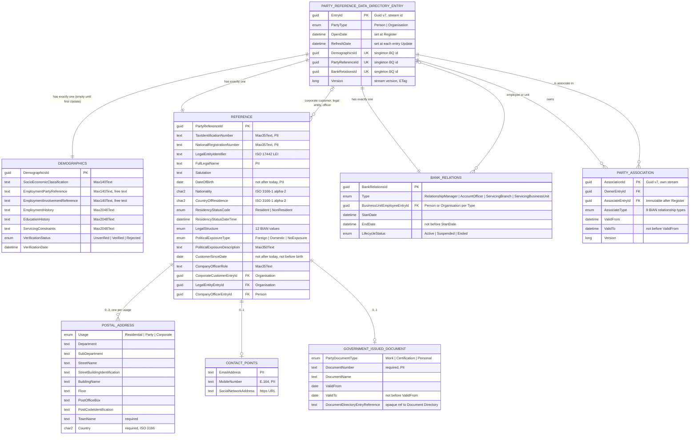
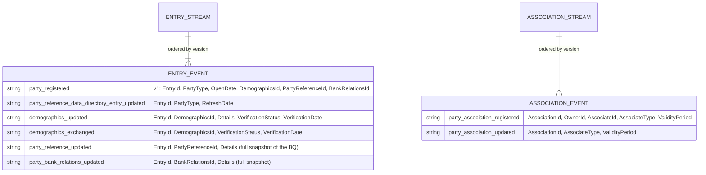
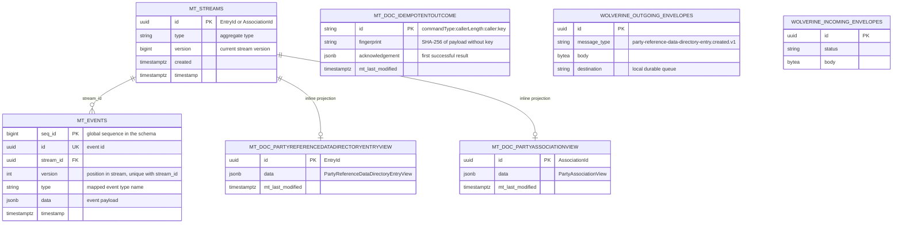
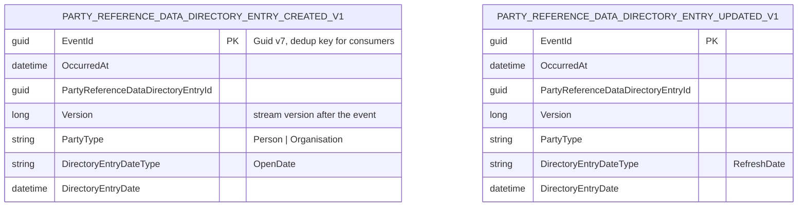

# 03. Data model and entity-relationship diagrams

RimBank is event-sourced, so there are three data models to understand, and they must not be confused:

| Model | What it is | Authoritative? | Where |
|---|---|---|---|
| **Domain model** (conceptual / logical) | Aggregates, entities and value objects in the core | Yes: decisions run against it | `RimBank.Core/Party/PartyReferenceDataDirectory` |
| **Event model** | The append-only streams of domain events that *are* the state | **Yes: the system of record** | Marten event tables in schema `party_reference_data_directory` |
| **Read model** | Views projected from events, shaped for queries | No: disposable, rebuildable at any time | Marten document tables in the same schema |

## 1. Logical domain ERD (Party Reference Data Directory)

Cardinalities are what the decisions enforce. Value objects are shown as attributes of their owning entity; [the business glossary](../business/02-party-domain-glossary.md) defines every member.

### Consistency boundaries

| Boundary | Contains | Transactional guarantee |
|---|---|---|
| Entry stream | Entry + Demographics + Reference + BankRelations | Every rule inside it is checked atomically against the current version |
| Association stream | One association | Atomic per association; many per party without contention on the party's stream ([ADR 0024](../adr/0024-party-reference-data-directory-mapping.md)) |
| Cross-aggregate references (FK lines above) | Ids of other entries | Checked on the **write side** at decision time (the handler loads the referenced entry). Not a database foreign key: a later change to the referenced entry does not cascade |

## 2. Event model

Every state change is one of these events. The first column is the Marten event type name stored in the database (`PartyReferenceDataDirectoryPostgresql.Configure`).

Design notes:

- **BQ events carry the full BQ state after the change** (not a delta). `Evolve` replaces the BQ; projections stay trivial; replays are deterministic.
- Event type names are **mapped explicitly** so that renaming a C# type never breaks stored history.
- Events are internal. Only `.PublishedLanguage` events leave the context (section 4).

## 3. Physical model (PostgreSQL)

One database (`rimbank`), one schema and one login role per context ([ADR 0016](../adr/0016-per-context-marten-stores.md)). Tables are created and migrated by Marten and Wolverine; names below are the libraries' conventions and may vary with their versions.

| Object | Schema | Owner role | Written by | Read by |
|---|---|---|---|---|
| Event streams (`mt_events`, `mt_streams`) | `party_reference_data_directory` | `rimbank_party_reference_data_directory` | Write port (`AppendToEntry`, …) | Write port (load), projections |
| Entry and association views | same | same | Inline projections, in the append transaction | Read port only |
| Idempotent outcomes | same | same | `IdempotencyGate.Remember`, in the append transaction | `IdempotencyGate.EnterAsync` |
| Outbox / inbox envelopes | same | same | Wolverine, in the append transaction | Wolverine durability agent |
| Wolverine node bookkeeping | `wolverine` | `rimbank_wolverine` | Host | Host; **no context has grants** |

**Isolation proof:** an integration test proves one context's role cannot read another context's schema (roadmap 0.10). When Stage 2 adds `product_directory`, Party's role still cannot see it, and vice versa.

## 4. Published language (integration contract)

| Channel (BIAN AsyncAPI) | Message identity | Emitted when |
|---|---|---|
| `PartyReferenceDataDirectoryEntry/Created` | `party-reference-data-directory-entry.created.v1` | `PartyRegistered` |
| `PartyReferenceDataDirectoryEntry/Updated` | `party-reference-data-directory-entry.updated.v1` | `PartyReferenceDataDirectoryEntryUpdated` |

The eight BQ channels (Demographics/Reference/Associations/BankRelations Created/Updated) are deferred ([ADR 0024](../adr/0024-party-reference-data-directory-mapping.md)). The contract deliberately carries **no PII**: it is enough for a consumer to know a party exists, its type and its version ([ADR 0036](../adr/0036-party-published-language.md)). A JSON-schema snapshot test pins each message so it can only evolve backwards-compatibly.

## 5. Read models

| View | Key | Lifecycle | Shape | Served operations |
|---|---|---|---|---|
| `PartyReferenceDataDirectoryEntryView` | EntryId | Inline | Entry header + version + Demographics + Reference + BankRelations | Entry, Demographics, Reference, BankRelations Retrieve |
| `PartyAssociationView` | AssociationId | Inline | Owner, associate, type, validity, version | Associations Retrieve |

Both are inline because callers read their own writes immediately (ETag from the command, then Retrieve). Cross-stream views (search, lists, "all associations of a party") are async projections when a phase needs them ([tech-stack §8.3](../../specs/tech-stack.md#83-projection-lifecycle-when-to-use-which)). Every view is rebuildable with `RebuildViewAsync`.

## 6. Shared kernel value types used in persistence

| Type | Representation | Standard |
|---|---|---|
| Typed ids (`…Id`) | `uuid`, Guid **v7** (time-ordered) | RFC 9562 |
| `CountryCode` | 2-letter upper-case string | ISO 3166-1 alpha-2 |
| `Currency` / `Money` (Stage 3+) | ISO code + `decimal` amount, minor-unit rules | ISO 4217 |
| Dates | `DateOnly` → `YYYY-MM-DD`; instants `DateTimeOffset` in UTC | ISO 8601 |
| Reference texts | Plain JSON strings, validated on read | ISO 20022 `MaxNText` |
