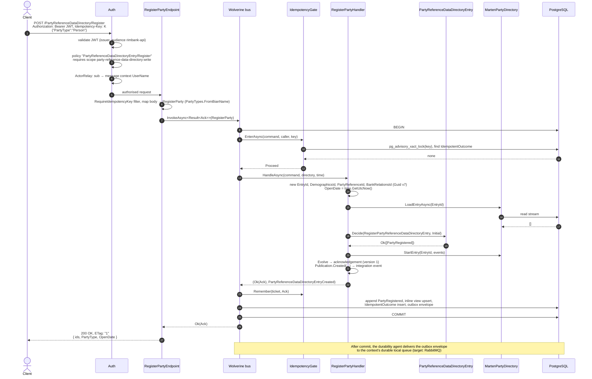
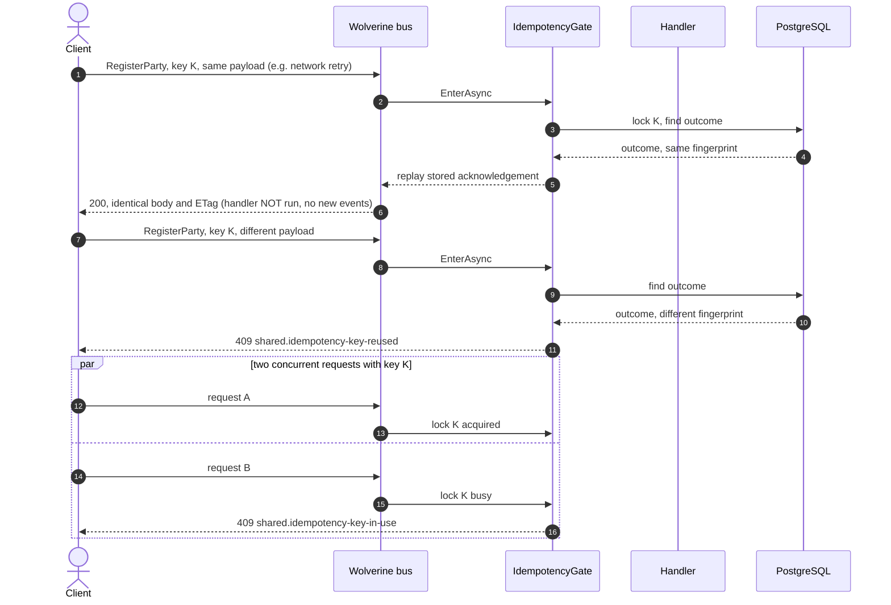
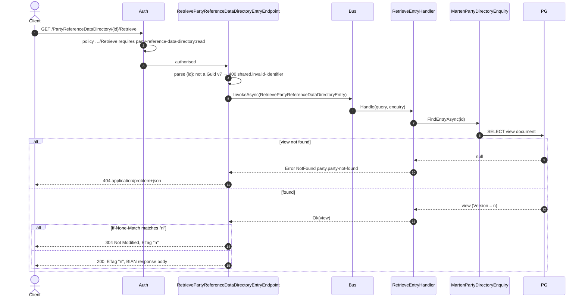
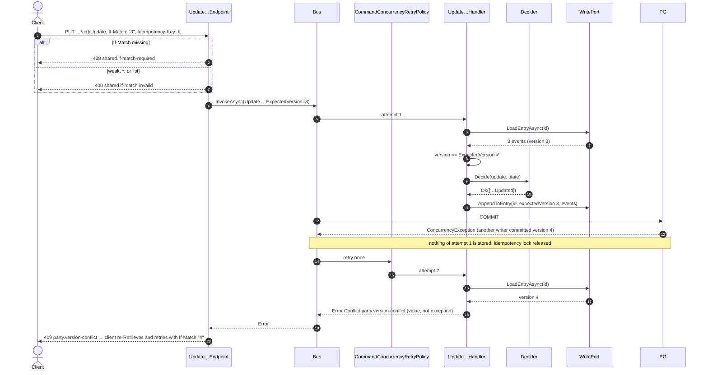
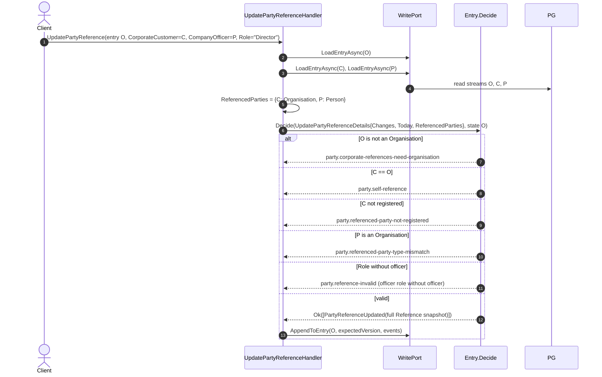
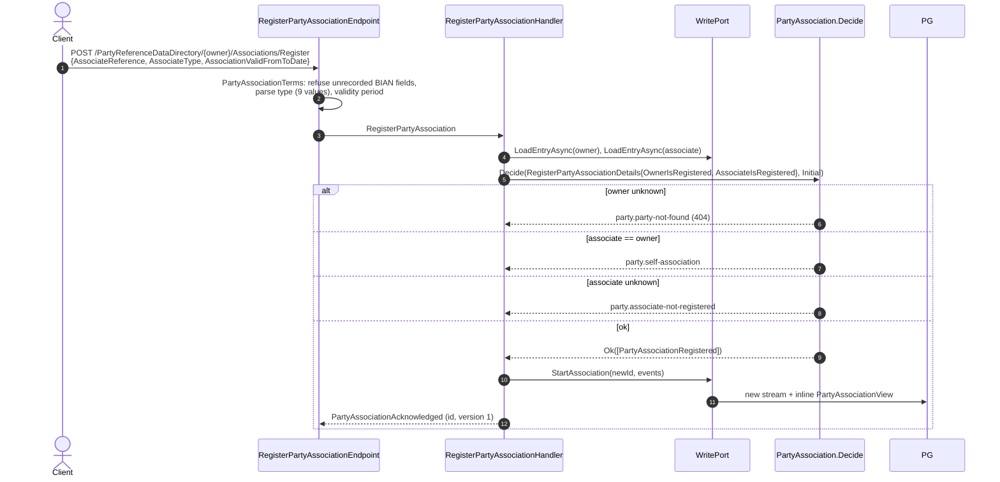
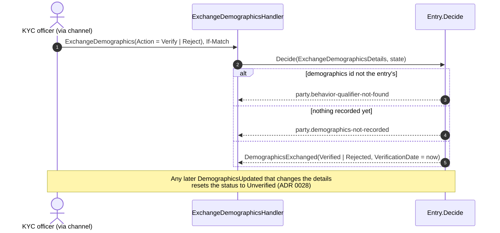
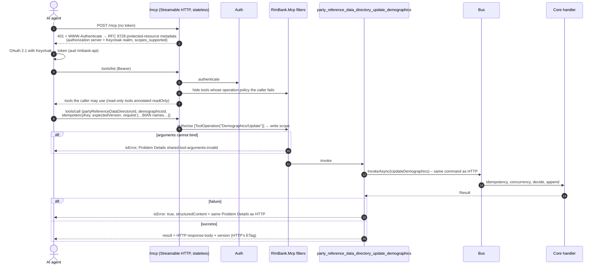
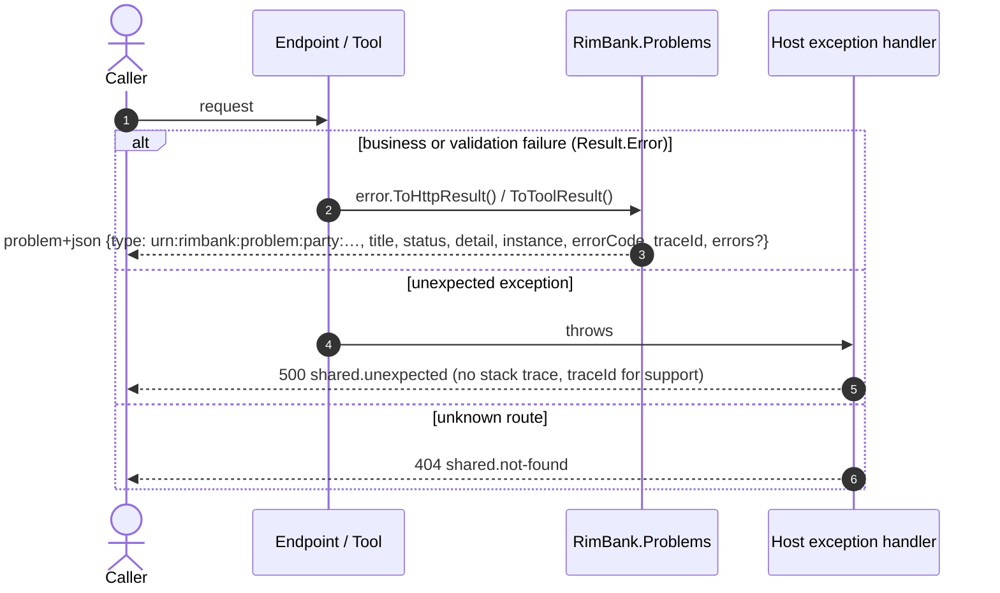
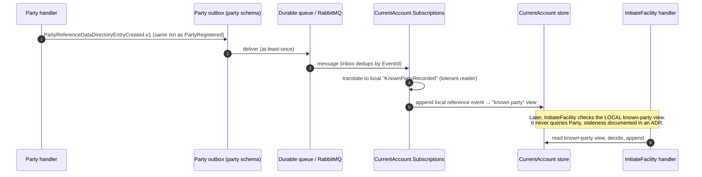

# 04. Sequence diagrams

Each diagram shows the real components and the order of checks. Participants:

| Short name | Component |
|---|---|
| Client | A BIAN HTTP client (bank channel) |
| Agent | An MCP client (AI agent) |
| Auth | ASP.NET Core authentication + `OperationPolicies` + `ActorRelay` (`RimBank.Host/Security`) |
| Endpoint | The context's endpoint in `RimBank.Api` |
| Tool | The context's tool in `RimBank.Mcp` |
| Bus | Wolverine `IMessageBus` with the idempotency and concurrency-retry policies (`RimBank.Postgresql`) |
| Handler | Command or query handler in `RimBank.Core` |
| Decider | The aggregate's pure `Decide` / `Evolve` |
| WritePort / ReadPort | `MartenPartyDirectory` / `MartenPartyDirectoryEnquiry` |
| PG | PostgreSQL schema `party_reference_data_directory` |

## 1. Register a party (command, happy path)

Key properties: one database transaction holds events, view, idempotency outcome and outbox, so they are **all or nothing**. The response is built from the acknowledgement, never from the view.

## 2. Same command retried (idempotent replay) and misuse

Keys are scoped to *context + command type + caller subject*: two callers using the same key never interfere ([ADR 0018](../adr/0018-idempotency-keys-for-commands.md), [ADR 0019](../adr/0019-authentication-baseline.md)). Only successes are stored, so a failed command can be retried with the same key.

## 3. Retrieve with ETag and conditional GET (query)

No idempotency, no transaction, no write port: the CQRS architecture rules forbid a query handler from touching aggregates or the write port.

## 4. Update with optimistic concurrency and lost-race retry

## 5. Update Reference with corporate references (cross-aggregate check on the write side)

Only stream **O** is appended. C and P are read for validation only; their later changes do not cascade (documented staleness, [ADR 0034](../adr/0034-reference-corporate-and-officer-references.md)).

## 6. Register a party association (own aggregate)

## 7. Demographics verification (Exchange)

## 8. MCP tool call (AI agent), same core

Parity tests assert that HTTP and MCP return the same JSON and the same Problem Details for the same operation ([ADR 0039](../adr/0039-party-mcp-tools.md)).

## 9. Error handling path (any request)

## 10. Planned: cross-context integration (Stage 4, target)

How Current Account will learn about parties without calling Party ([tech-stack §8.4](../../specs/tech-stack.md#84-read-models-across-contexts-loose-coupling)).

