# 05. Logic flows and state machines

Flowcharts of the request pipeline and of each decision, and state machines for every lifecycle in the Party context. Decision order matters: it defines *which* error a caller receives when several rules fail, and it is pinned by tests.

## 1. Request pipeline (HTTP command)

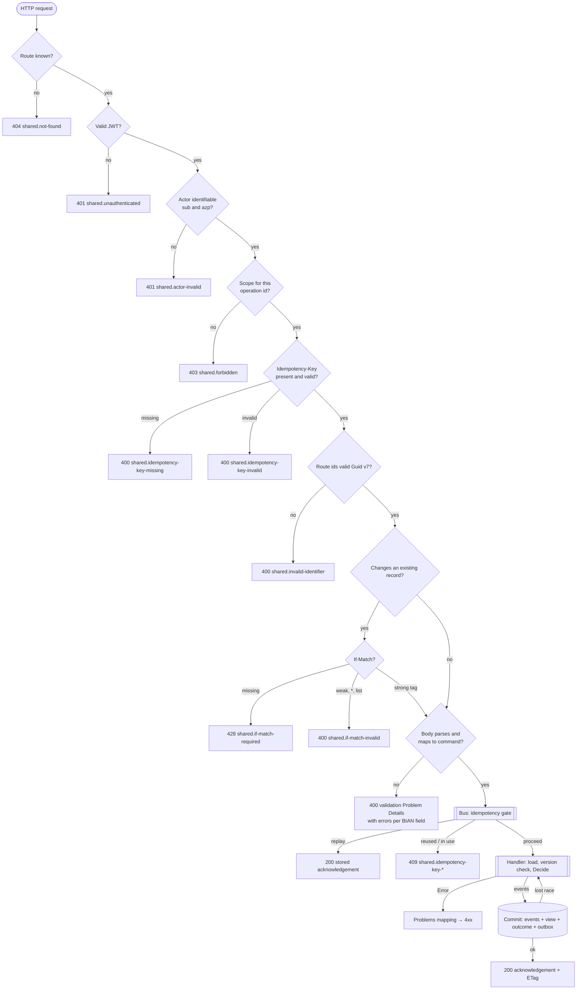

Queries follow the same pipeline up to the scope check (read scope), then skip idempotency, `If-Match` and the transaction; they add the `If-None-Match` → 304 branch.

## 2. Entry decision (`PartyReferenceDataDirectoryEntry.Decide`)

The `switch` in `Decisions.cs`, as a decision tree. First matching rule wins.

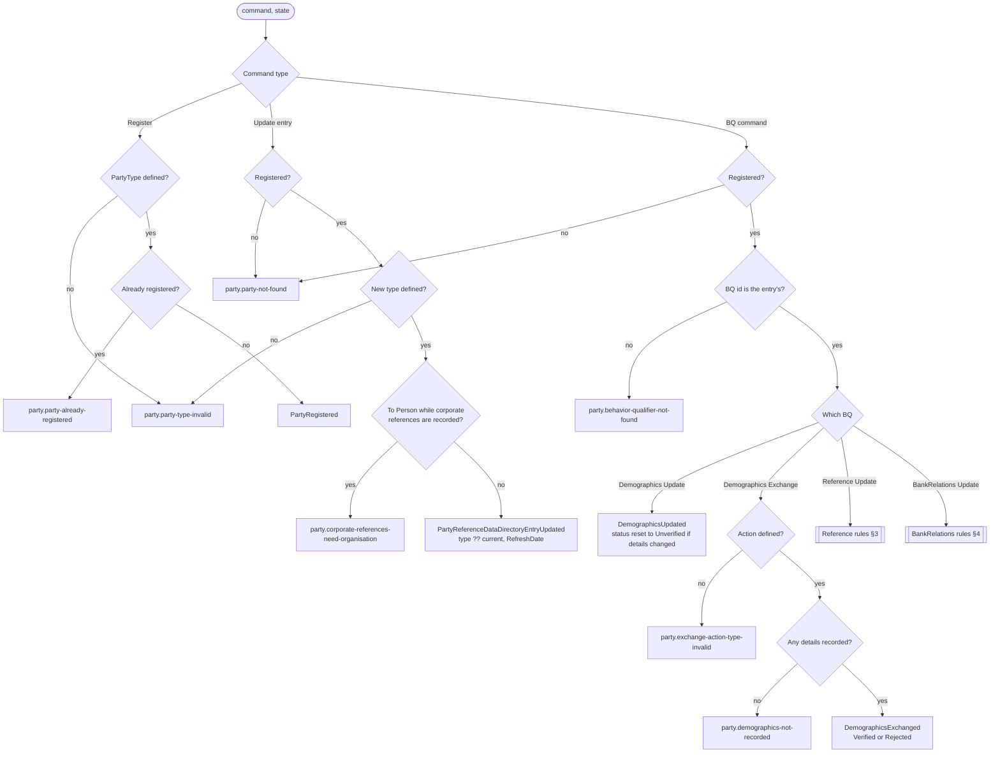

## 3. Reference update rules

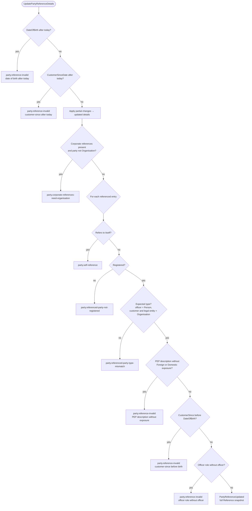

Field-level validation (ISO 20022 lengths, LEI check digits, E.164, ISO 3166, address town and country required, document validity order) runs **before** the decision when the adapter builds `PartyReferenceChanges`, returning `party.reference-invalid` with per-field `errors`. Fields BIAN defines but RimBank does not yet record are refused with `party.reference-field-not-supported` rather than silently dropped ([ADR 0029](../adr/0029-reference-fields-in-stages.md)).

## 4. BankRelations update rules

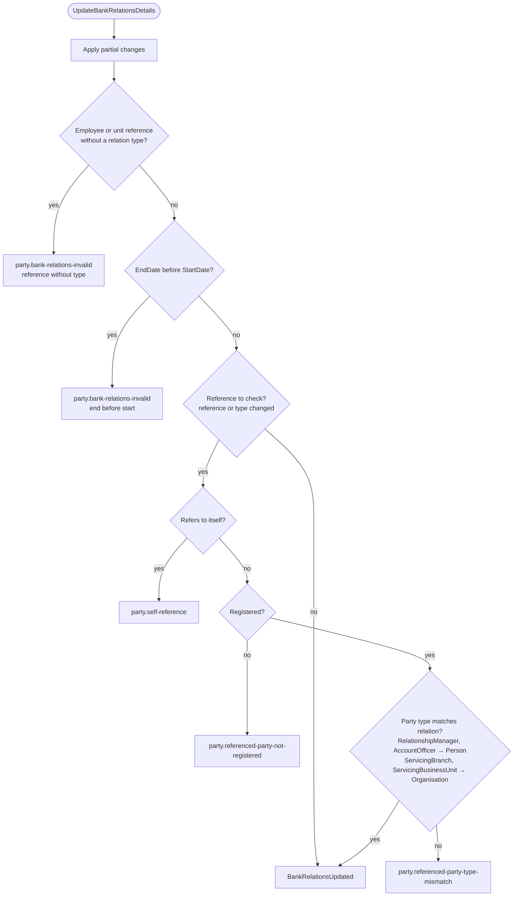

## 5. Association decision

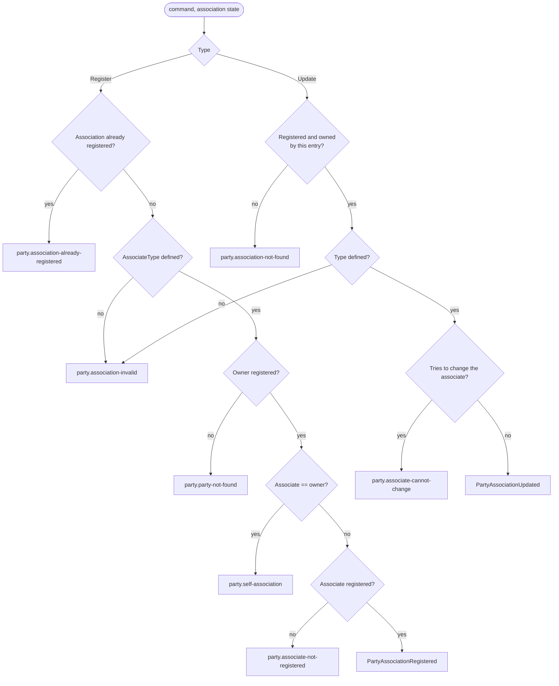

## 6. State machines

### 6.1 Directory entry lifecycle

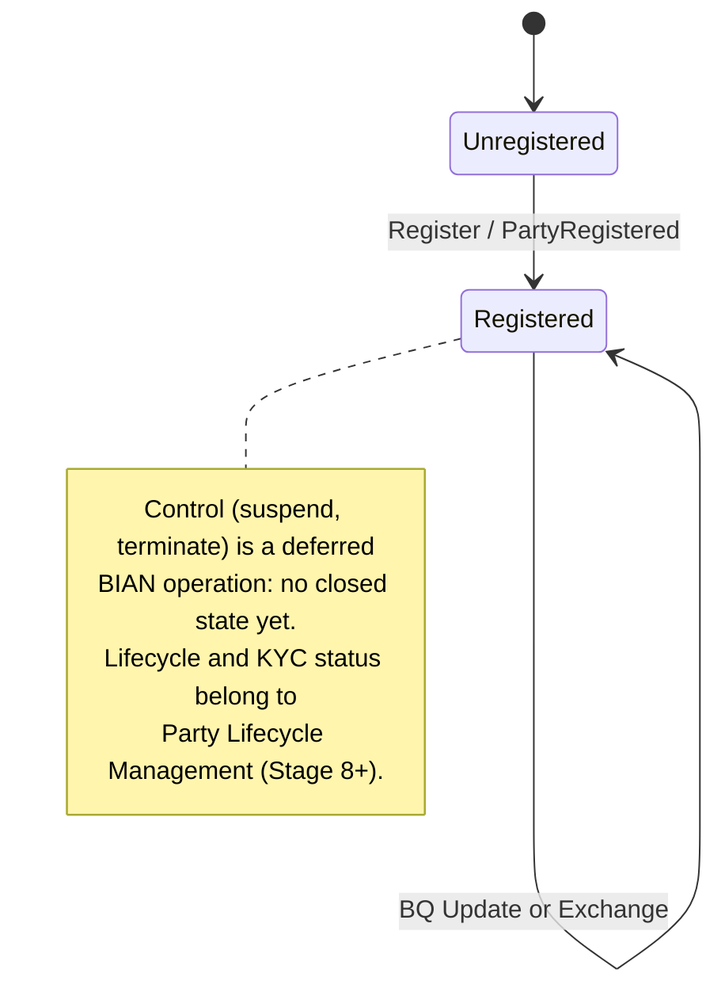

### 6.2 Demographics verification ([ADR 0028](../adr/0028-demographics-exchange-as-verification.md))

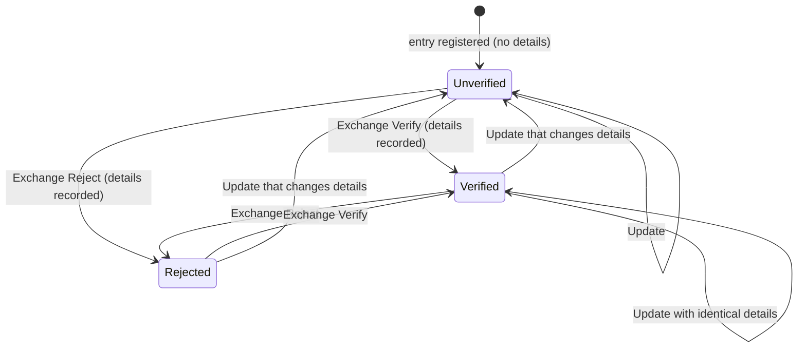

### 6.3 Bank relation lifecycle ([ADR 0035](../adr/0035-party-bank-relations.md))

The status is **recorded**, not enforced as transitions: the bank declares it. The diagram shows the intended business meaning.

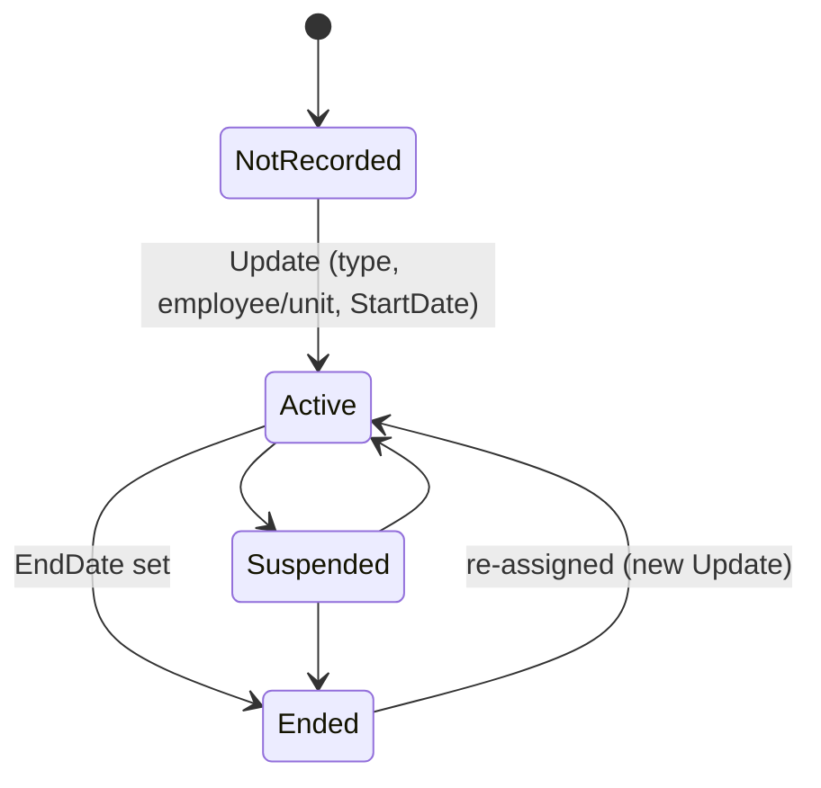

### 6.4 Party association

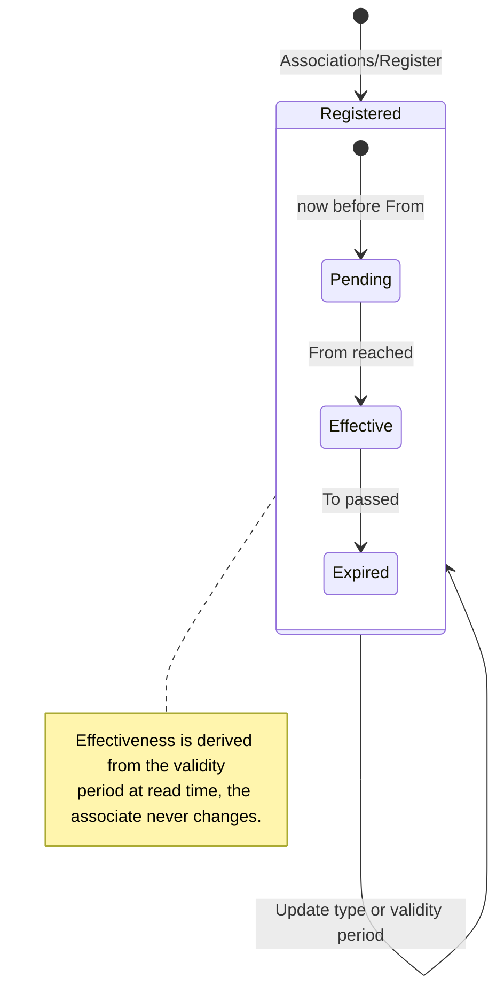

### 6.5 Command message (idempotency × concurrency)

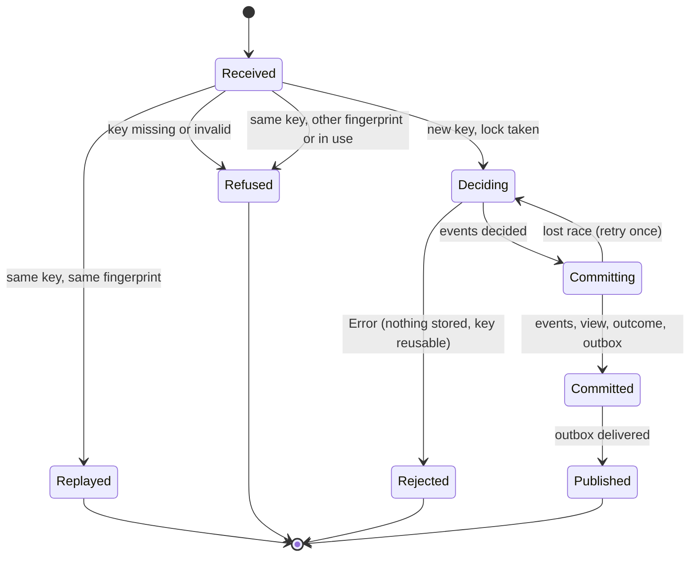

## 7. Read-model rebuild flow

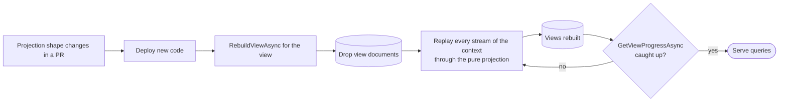

The zero-downtime variant (blue/green view tables) is roadmap 7.4.
