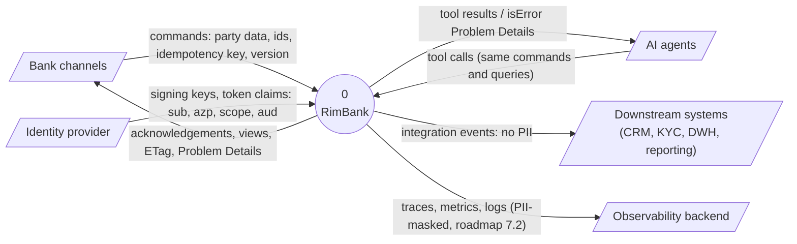
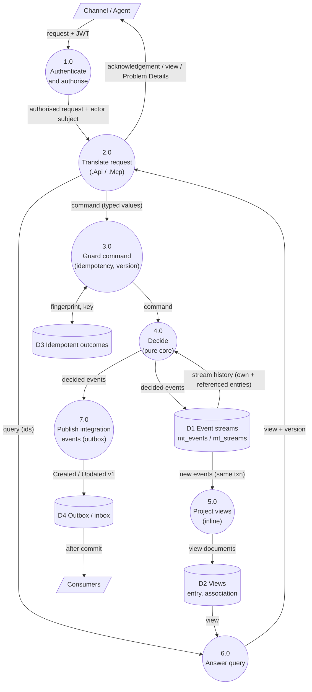
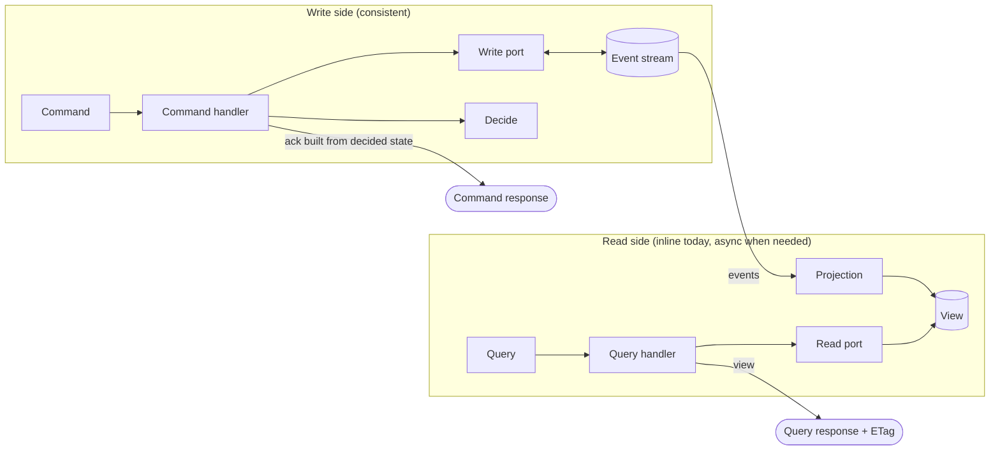
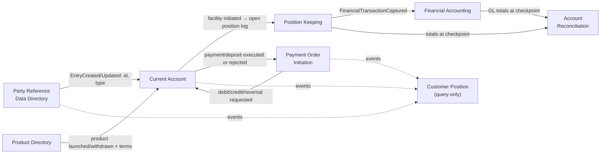
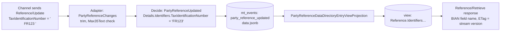

# 06. Data flow

Data-flow diagrams (DFD) in the Gane–Sarson spirit: external entities, processes, data stores and flows, at increasing depth. Then data classification and lineage.

## 1. DFD level 0 (context)

## 2. DFD level 1 (inside RimBank, Party context)

**Invariant flows:**

- D1 is written **only** by process 4 through the write port. Nothing else writes events.
- D2 is written **only** by process 5. Queries (6) never read D1; commands (4) never read D2.
- D3, D1, D2 and D4 writes for a command share **one PostgreSQL transaction**.
- Process 7 maps from **decided events**, never from D2 ([ADR 0036](../adr/0036-party-published-language.md)).

## 3. CQRS data paths

## 4. Cross-context data flow *(target, Stages 2–6)*

Each context owns its data; others receive only what they need, via events, and keep their own minimal copy ([tech-stack §8.4](../../specs/tech-stack.md#84-read-models-across-contexts-loose-coupling)).

| Data | Owner (system of record) | Copies allowed | Copy content |
|---|---|---|---|
| Party identity and type | Party Reference Data Directory | Current Account, Customer Position | Entry id, party type, "known" flag; **no PII** |
| Party demographics, identifiers, addresses, contacts | Party Reference Data Directory | None by default | Consumers that need them get them through future BQ channels, with an ADR |
| Product terms | Product Directory | Current Account | Currency, fees, interest terms needed for decisions |
| Authoritative balance | Decided in ADR 3.1 (write-side) | Views only | Projections never used for funds checks |
| GL postings | Financial Accounting | Reconciliation | Totals at checkpoints |

## 5. Data classification

| Class | Examples in Party | Where it exists | Controls today | Planned |
|---|---|---|---|---|
| **Sensitive personal data** | Tax id, national registration number, date of birth, government document number, political exposure | D1 (event payloads), D2 (views) | Per-context DB role, TLS, authenticated and scoped access, no PII in integration events | Field protection at rest in streams and views, log masking (roadmap 7.2) |
| **Personal data** | Full legal name, salutation, addresses, email, mobile, social network, nationality, residency, employment, education, servicing constraints | D1, D2 | Same | Same |
| **Business reference** | Party type, LEI, legal structure, relationships, bank relations, dates | D1, D2, events (type only) | Same | — |
| **Operational** | Idempotency fingerprints (SHA-256, never the payload), envelopes, traces | D3, D4, telemetry | Fingerprint only; trace carries `enduser.id` (subject) | Audit query API (7.3) |
| **Secrets** | DB role passwords, client secrets | User secrets locally; vault elsewhere | Never in source; Aspire generates 32-char role passwords | — |

### GDPR / privacy note

Event sourcing makes the audit trail immutable, which conflicts with erasure requests on personal data. The planned approach (roadmap 7.2) is protection of sensitive fields at rest so personal data can be made unreadable without rewriting history (e.g. per-subject key "crypto-shredding"). It needs its own ADR before Stage 7; until then **RimBank must not hold production personal data**.

## 6. Data lineage of a Retrieve response field

Every value in a response can be traced back to one event in one stream, at one version, written by one actor at one time: that is the audit property the mission asks for.
