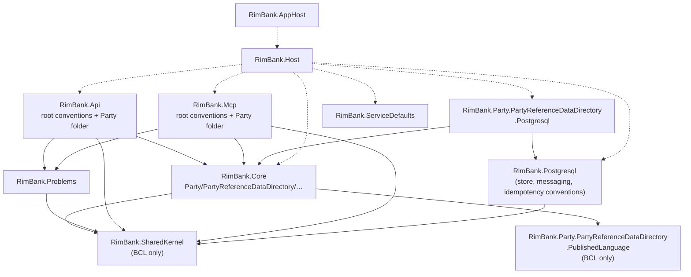
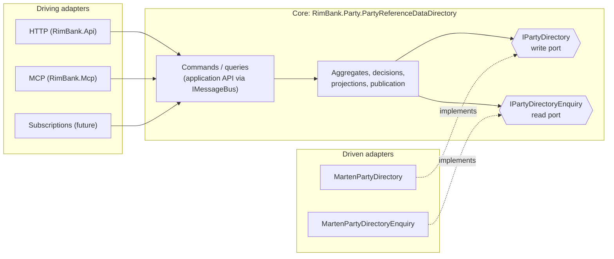
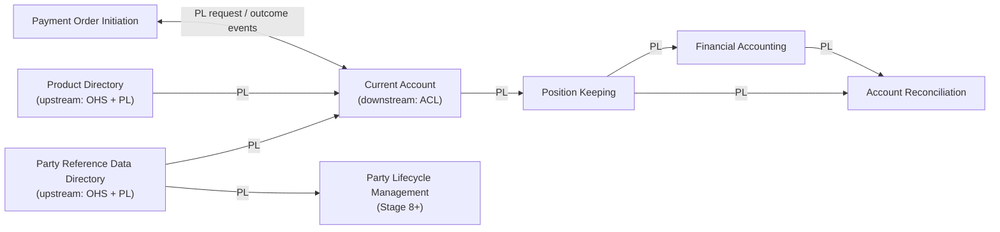

# 07. Dependencies

Three kinds of dependency, each governed differently:

1. **Code dependencies** between projects and namespaces: enforced by ArchUnitNET tests (`RimBank.Architecture.Tests`), proven to bite by good/bad fixtures (`RimBank.Architecture.Fixtures`).
2. **Runtime dependencies** on infrastructure: PostgreSQL, the identity provider, telemetry.
3. **Context dependencies** between bounded contexts: only through published language, enforced by architecture tests and database roles.

## 1. Project dependency graph (today)

Arrows mean "references". Dashed = composition only.

## 2. Dependency rules

The normative table is [tech-stack §4](../../specs/tech-stack.md#4-dependency-rules-enforced-by-architecture-tests). Summary as a matrix: ✅ allowed, ❌ forbidden (test fails), — not applicable.

| From ↓ / To → | SharedKernel | Own core | Other core | Own PL | Other PL | Problems | ASP.NET | Marten / Npgsql | Wolverine | MCP SDK |
|---|---|---|---|---|---|---|---|---|---|---|
| SharedKernel | — | ❌ | ❌ | ❌ | ❌ | ❌ | ❌ | ❌ | ❌ | ❌ |
| Core (a context) | ✅ | — | ❌ | ✅ | ❌ | ❌ | ❌ | ❌ | ❌ | ❌ |
| .PublishedLanguage | ❌ | ❌ | ❌ | — | ❌ | ❌ | ❌ | ❌ | ❌ | ❌ |
| .Api folder | ✅ | ✅ | ❌ | ✅ | ❌ | ✅ | ✅ | ❌ | ✅ `IMessageBus` | ❌ |
| .Mcp folder | ✅ | ✅ | ❌ | ✅ | ❌ | ✅ | ✅ | ❌ | ✅ `IMessageBus` | ✅ |
| .Postgresql | ✅ | ✅ | ❌ | ✅ | ❌ | ❌ | ❌ | ✅ | ✅ `Wolverine.Marten` | ❌ |
| .Subscriptions *(future)* | ✅ | ✅ | ❌ | ✅ | ✅ **only here** | ❌ | ❌ | ❌ | ✅ | ❌ |
| RimBank.Problems | ✅ | ❌ | ❌ | ❌ | ❌ | — | ✅ | ❌ | ❌ | ❌ |
| RimBank.Host | ✅ | ✅ composition | ✅ composition | ✅ | ✅ | ✅ | ✅ | ✅ | ✅ | ✅ |

Additional enforced rules:

| Rule | What it prevents |
|---|---|
| `cross-context-isolation` | A context's code in `RimBank.Core` using another context's namespace |
| `context-namespaces-stop-at-the-adapter` | Folder names leaking into namespaces ([ADR 0026](../adr/0026-flat-context-namespaces.md)) |
| CQRS role rules ([ADR 0012](../adr/0012-cqrs-role-markers.md)) | Command handlers reading views; query handlers touching aggregates or write ports; projections using ports, handlers or `TimeProvider` |
| Forbidden folders | `Services`, `Repositories`, `Helpers`, `Managers`, `Utils`, `Dtos` in the core |
| Typed ids are `readonly record struct` | Reference-type ids and accidental nulls ([ADR 0008](../adr/0008-typed-identifier-pattern.md)) |
| No `double` / `float` in cores, SharedKernel, PublishedLanguage | Binary floating point for money ([ADR 0009](../adr/0009-money-and-currency.md)) |
| Deciders implement `IDecider`, projections `IProjection` | Bypassing the functional contracts ([ADR 0010](../adr/0010-decider-and-projection-contracts.md)) |
| `allow-anonymous-only-in-service-defaults` | Accidentally anonymous business endpoints ([ADR 0019](../adr/0019-authentication-baseline.md)) |
| Test namespaces end with `.Tests` | Test code drifting into production namespaces |

## 3. Hexagonal view (ports and adapters)

The core has **no package reference** to Wolverine or Marten: handlers are plain static classes with `Handle`/`HandleAsync` methods that return values (Wolverine's cascading convention); time comes from `TimeProvider`.

## 4. Third-party package dependencies

All versions are pinned centrally in `Directory.Packages.props`, with lock files and locked restore in CI; Dependabot proposes updates and NuGet audit fails on known vulnerabilities ([ADR 0013](../adr/0013-warning-and-package-governance.md)).

| Package family | Used by | Purpose | Replaceability |
|---|---|---|---|
| ASP.NET Core (Minimal APIs, OpenAPI, JWT bearer) | Host, Api, Mcp, Problems | HTTP, auth, OpenAPI document | Platform |
| Scalar | Host (Development) | API reference UI | Trivial |
| `ModelContextProtocol.AspNetCore` | Mcp, Host | MCP server, Streamable HTTP | Adapter-local |
| WolverineFx (+ `.Marten`, `.Postgresql`) | Host, RimBank.Postgresql, adapters | Bus, outbox/inbox, retries, scheduled messages, sagas | Adapter-local: core is framework-free |
| Marten (+ Weasel, Npgsql, JasperFx) | RimBank.Postgresql, `.Postgresql` | Event store, documents, projections, async daemon | Adapter-local: ports in core |
| .NET Aspire (+ Keycloak hosting/auth previews, pinned as `AspireKeycloakVersion`) | AppHost, ServiceDefaults, Host | Orchestration, service defaults | Dev/test tooling |
| OpenTelemetry | ServiceDefaults | Traces, metrics, logs | Standard |
| xUnit v3, Shouldly, FsCheck, Alba, Testcontainers, ArchUnitNET, Microsoft.OpenApi, YamlDotNet | tests | Test platform ([ADR 0007](../adr/0007-test-platform.md)) | Test-only |

## 5. Runtime dependencies

| Dependency | Needed for | If unavailable | Health signal |
|---|---|---|---|
| PostgreSQL | Every command and query of a context | That context answers 500 `shared.unexpected`; other contexts with healthy stores keep working | `postgresql-<service-domain>` check, tag `ready` |
| Identity provider (JWKS) | Validating new tokens | Cached keys keep working until rotation; otherwise 401 | Startup / auth failures in telemetry |
| OTLP endpoint | Telemetry export | No functional impact | Exporter errors |
| RabbitMQ *(future)* | Inter-service events after extraction | Outbox buffers; delivery resumes | Wolverine transport health |

## 6. Context dependency map *(target)*

Upstream/downstream relationships in DDD context-mapping terms. Every arrow is **published language + conformist-free consumer** (the consumer translates in its own `.Subscriptions`: anticorruption layer).

OHS = open host service (BIAN API), PL = published language, ACL = anticorruption layer. There are **no** synchronous cross-context calls; adding one requires an explicit port and an ADR.
