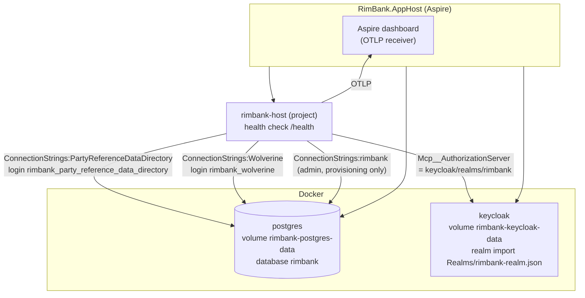
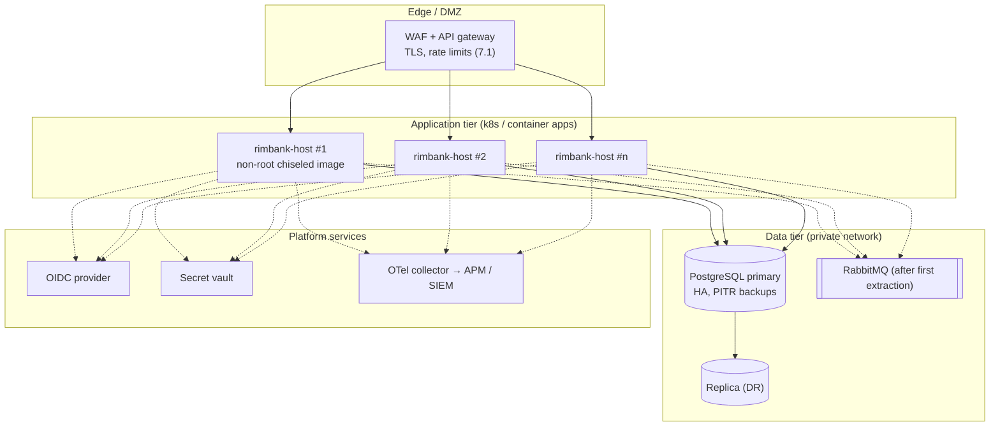
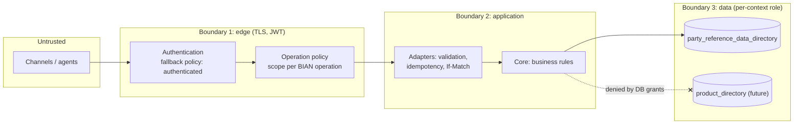
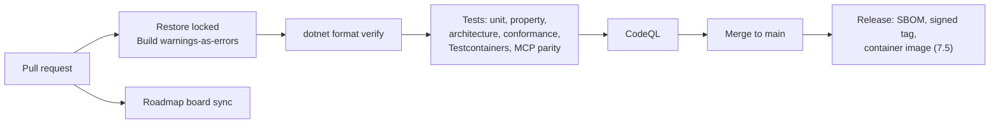

# 08. Deployment, security and operations

## 1. Local / test topology (.NET Aspire)

`dotnet run --project src/RimBank.AppHost` starts everything with Docker.

- One connection string per context role; each password is an Aspire secret parameter (32 chars, persisted).
- Role and schema provisioning runs at startup only when `RimBank:Postgresql:ProvisionRoles` is on (default: Development only). In other environments, a DBA or migration pipeline creates roles.
- The host refuses to start if a context's connection string logs in as a different role than its own ([ADR 0016](../adr/0016-per-context-marten-stores.md)).

## 2. Reference production deployment *(recommended, not yet shipped)*

Container images and signing are roadmap 7.5. This is the target shape an adopter should implement.

| Concern | Guidance |
|---|---|
| Scaling | Stateless hosts behind a load balancer; Wolverine `Balanced` durability distributes outbox/inbox work and async-daemon leadership across nodes |
| Readiness | Use the `ready`-tagged health checks (one per context store); liveness on `/health` |
| Database | One database, schema per context; contexts can later move to separate databases by changing only connection strings |
| Backups | PostgreSQL PITR. Event streams are the source of truth: views can be rebuilt, streams cannot |
| Secrets | From a vault; never in `appsettings` |
| Config | `Authentication:Authority` (HTTPS) outside Development; MCP authorization server URL |

## 3. Security architecture

### 3.1 Trust boundaries

### 3.2 Controls by layer

| Layer | Control | Evidence |
|---|---|---|
| Identity | OIDC / JWT bearer, audience `rimbank-api`; Keycloak locally | [ADR 0019](../adr/0019-authentication-baseline.md), host tests with test-signed tokens |
| Default deny | Authorization fallback policy requires an authenticated caller; only health probes (and dev-only OpenAPI/Scalar) are anonymous | Architecture rule `allow-anonymous-only-in-service-defaults` |
| Authorisation | One policy per BIAN operation id; `<service-domain>:read` for queries, `:write` for commands; 403 before any other check | [ADR 0038](../adr/0038-per-operation-authorisation-policies.md), policy tests |
| MCP auth | OAuth 2.1 per the MCP authorization spec; 401 points to RFC 9728 protected-resource metadata; `scopes_supported` lists policy scopes; tools hidden from `tools/list` when the caller lacks the scope | [ADR 0022](../adr/0022-mcp-authorization-and-tool-errors.md), [ADR 0039](../adr/0039-party-mcp-tools.md) |
| Money-moving tools *(Stage 4)* | Dedicated scope, disabled by default, `destructive` annotation, idempotency key required | tech-stack §6 |
| Actor traceability | `sub` relayed as Wolverine user name → idempotency scope, Marten last-modified-by, trace `enduser.id` | `ActorRelay` |
| Input validation | Typed parsing at the edge (ids, ISO formats, lengths); unknown BIAN fields refused, not ignored, where RimBank does not record them | Conformance + API tests |
| Error hygiene | RFC 9457 only; no stack traces; `traceId` for support | [ADR 0015](../adr/0015-problem-details-mapping.md) |
| Data isolation | Per-context schema and login role with no grants elsewhere | Testcontainers isolation test |
| Integrity | Idempotency, optimistic concurrency, append-only events | [ADR 0018](../adr/0018-idempotency-keys-for-commands.md), [ADR 0027](../adr/0027-optimistic-concurrency-for-commands.md) |
| Supply chain | CodeQL, Dependabot, NuGet audit, locked restore, nuget.org-only source mapping; SBOM and signed releases planned (7.5) | [ADR 0005](../adr/0005-ci-and-supply-chain-policy.md), [ADR 0013](../adr/0013-warning-and-package-governance.md) |

### 3.3 STRIDE summary (Party context)

The full threat model is roadmap 7.8. Current position:

| Threat | Example | Mitigation today | Residual / planned |
|---|---|---|---|
| **S**poofing | Forged token | JWT signature, issuer, audience validation | mTLS for service-to-service (with extraction) |
| **T**ampering | Replayed or reordered update | Idempotency key + `If-Match` stream version | — |
| **R**epudiation | "I never changed that address" | Append-only events with actor subject and trace id | Audit query API (7.3) |
| **I**nformation disclosure | PII in logs or events | No PII in integration events; scoped read access; DB role isolation | Log masking and field protection at rest (7.2) |
| **D**enial of service | Flooding Register | Idempotency-key locks bound duplicate work | Rate limiting, 429 Problem Details (7.1, 7.9) |
| **E**levation of privilege | Read-scope token calling Update, or agent calling a write tool | Per-operation policy on HTTP and MCP; tools hidden without scope | Fine-grained ABAC (e.g. per branch) not in scope yet |

## 4. Observability

| Signal | Source | Content |
|---|---|---|
| Traces | ASP.NET Core, Wolverine, Npgsql instrumentation via `RimBank.ServiceDefaults` | One trace per request through the bus to PostgreSQL; `traceId` also in every Problem Details |
| Metrics | Runtime, ASP.NET Core, Wolverine | Request rates, latencies, error rates; projection lag metrics planned (7.4) |
| Logs | Structured `ILogger` | Correlated by trace; PII masking planned (7.2) |
| Health | `/health` (liveness), `ready` per context store | Used by Aspire and orchestrators |

### Operational runbooks (to be completed in Stage 7)

| Situation | First response |
|---|---|
| `409 party.version-conflict` spikes | Expected under contention; check clients re-Retrieve before retrying |
| `409 shared.idempotency-key-in-use` | A duplicate is in flight; client should wait and retry with the same key |
| View out of date or corrupted | `RebuildViewAsync`; streams are untouched |
| Outbox backlog grows | Check consumers/queues; envelopes are durable and will be delivered once healthy |
| One context's DB down | Only that context fails; others keep serving ([mission principle 7](../../specs/mission.md#guiding-principles)) |

## 5. CI/CD

Workflows: `.github/workflows/ci.yml`, `codeql.yml`, `roadmap-board.yml`.
