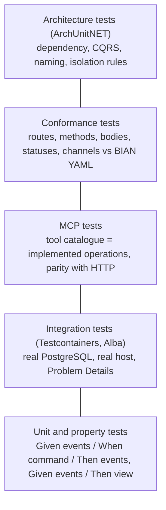
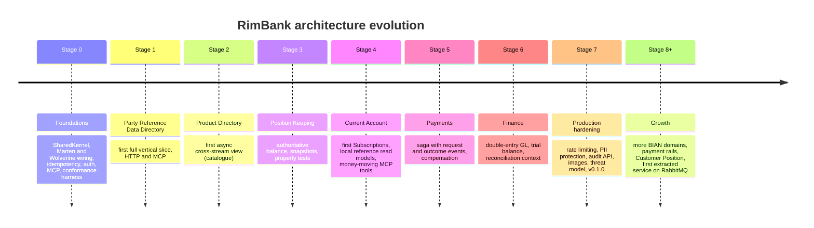

# 09. Quality attributes, risks and architecture roadmap

## 1. Quality attribute scenarios

Each scenario: *source → stimulus → response → measure*, and the evidence that it holds today.

| # | Quality | Scenario | Response and measure | Evidence |
|---|---|---|---|---|
| Q1 | Integrity | A channel retries `Register` after a timeout | Exactly one party registered; the retry receives the identical acknowledgement | Idempotency tests (`RimBank.Postgresql.Tests`, Api tests) |
| Q2 | Integrity | Two operators update the same party's Reference concurrently | One succeeds; the other gets 409 `party.version-conflict`; no lost update | Concurrency tests ([ADR 0027](../adr/0027-optimistic-concurrency-for-commands.md)) |
| Q3 | Auditability | An auditor asks who changed a party's tax id and when | Every change is an event with actor, time and trace | Event streams; query API in 7.3 |
| Q4 | Security | A token with only the read scope calls an Update endpoint or tool | 403 `shared.forbidden` before any other check; tool not listed | Policy tests on HTTP and MCP |
| Q5 | Interoperability | BIAN publishes a route the code does not match | Conformance test fails in CI | `RimBank.Conformance.Tests`, Api conformance tests |
| Q6 | Interoperability | An AI agent and a web app perform the same update | Same JSON result and same Problem Details | MCP parity tests |
| Q7 | Evolvability | A developer references Current Account's core from Party | Build-time architecture test fails | `RimBank.Architecture.Tests` |
| Q8 | Evolvability | A consumer adds a field to the Party event contract | Snapshot test fails unless the change is backwards-compatible | Published-language schema snapshot |
| Q9 | Recoverability | A projection bug corrupts views | Fix and `RebuildViewAsync`; no data loss | Rebuild tests (0.10) |
| Q10 | Availability | Party's store is unreachable | Only Party operations fail (500 Problem Details); other contexts unaffected | Per-context store and daemon |
| Q11 | Correctness of money *(Stage 3+)* | Any sequence of debits/credits | Balance equals the sum of transactions | FsCheck property tests planned (3.3) |
| Q12 | Performance *(Stage 7)* | Load on deposit, withdrawal, transfer | Baseline to be defined | Roadmap 7.6 |

## 2. Test pyramid as architecture fitness functions

## 3. Architecture risks

| # | Risk | Likelihood | Impact | Mitigation | Owner phase |
|---|---|---|---|---|---|
| R1 | Personal data in immutable event streams vs right to erasure | High (any real deployment) | High (regulatory) | Field protection at rest / crypto-shredding ADR before production use | 7.2 |
| R2 | Single shared database is a blast radius for all contexts | Medium | High | Per-context roles and schemas now; separate databases by configuration later | 7.x / extraction |
| R3 | Long-lived streams (accounts, positions) slow to load | Medium (Stage 3+) | Medium | Snapshot strategy decided in ADR 3.1 | 3.1 |
| R4 | Projection lag misleads callers on async views | Medium | Medium | Inline views for read-your-write; `GetViewProgressAsync`; lag metrics | 7.4 |
| R5 | BIAN spec defects or ambiguities (e.g. wrong 200 schema) | High | Low | Recorded per case in ADRs and conformance catalogues ([ADR 0037](../adr/0037-bian-body-and-payload-conformance.md)) | Ongoing |
| R6 | Preview packages (Aspire Keycloak) change | Medium | Low | Pinned version, isolated to AppHost and auth wiring | Ongoing |
| R7 | Cross-aggregate references become stale (referenced party changes type later) | Low | Medium | Checked at write time; documented staleness; lifecycle events later | ADR 0034/0035 |
| R8 | AI agents performing harmful bulk actions | Medium | High | Scoped tools, read-only annotations, money tools off by default, per-client rate limits | 4.14, 7.9 |
| R9 | No rate limiting yet | High | Medium | Gateway rate limiting in deployments until 7.1 | 7.1 |

## 4. Technical debt and deliberate deferrals

| Item | Why deferred | Where recorded |
|---|---|---|
| BIAN CR operations Control, Request, Execute, Exchange | No business behaviour defined yet for the directory | [ADR 0024](../adr/0024-party-reference-data-directory-mapping.md) |
| Eight BQ AsyncAPI channels | No consumer needs them; avoid spreading PII | ADR 0024, [ADR 0036](../adr/0036-party-published-language.md) |
| List / search parties | Needs async cross-stream projection; no consumer yet | tech-stack §8.3 |
| "All associations of a party" query | Same | ADR 0033 |
| KYC status, screening results, risk rating | Belong to other BIAN domains (Party Lifecycle Management, Regulatory Compliance); RimBank stores the party's declarations only | [ADR 0032](../adr/0032-reference-legal-standing-and-documents.md) |
| Container images, SBOM, signed releases | Stage 7 | 7.5 |

## 5. Readiness checklist before Stage 2 (Product Directory)

| Area | Status |
|---|---|
| Slice pattern proven end to end (ADR → aggregate → command → Postgres → API → query → BQs → published language → conformance → policies → MCP) | ✅ Stage 1 |
| Conventions reusable by a second context (store, messaging, idempotency, Problem Details, policies, MCP filters) | ✅ in composition projects |
| Architecture tests ready for a second context (cross-context isolation inside `RimBank.Core`) | ✅ fixtures cover it |
| First consumer-side integration (`.Subscriptions`) | ⏳ Stage 4.1, needs an ADR |
| Async cross-stream projection in production code | ⏳ Stage 2.5 (product catalogue) |

## 6. Architecture roadmap

