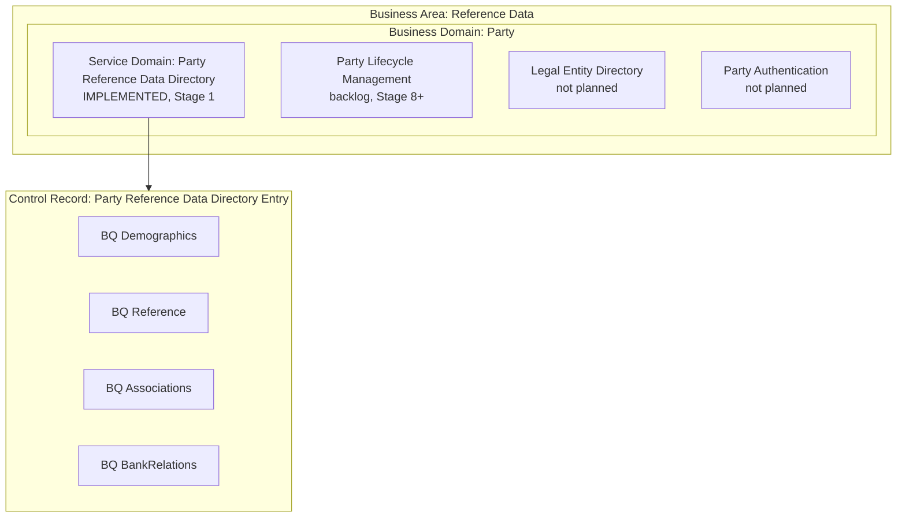
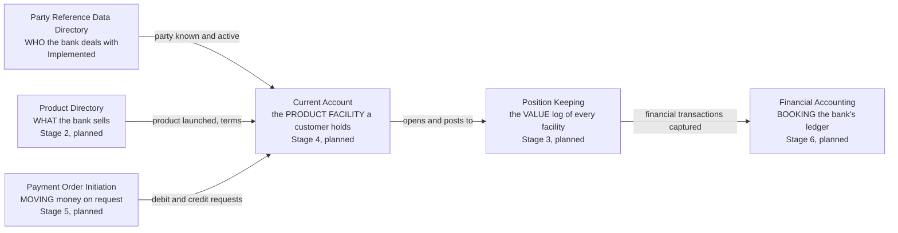
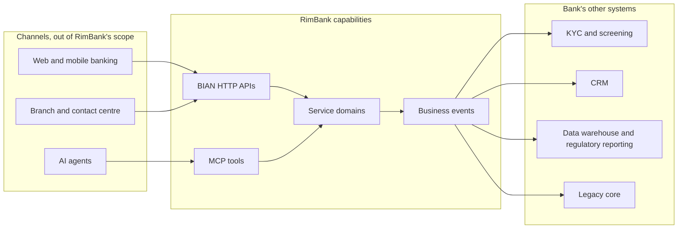

# 1. Business architecture

> Audience: bank business analysts, product owners, enterprise and solution architects.
> Sources: the BIAN v14 ISO 20022 extended DDD specifications in [`doc-0/release14.0.0/`](../../doc-0/release14.0.0/), the [mission](../../specs/mission.md), the [roadmap](../../specs/roadmap.md) and the ADRs in [`docs/adr/`](../adr/).
> Definitions in quotation marks are quoted verbatim from the BIAN v14 OpenAPI files. Everything else is RimBank's reading and is marked as such.

## 1.1 What RimBank is, in business terms

RimBank is an open-source **core banking platform** whose building blocks are the **service domains** of the BIAN (Banking Industry Architecture Network) Service Landscape v14. Each BIAN service domain is one self-contained business capability, delivered as:

- a **BIAN HTTP API** (the operations BIAN names: Register, Update, Exchange, Retrieve, …),
- a set of **MCP tools**, so that AI agents can use the same capability with the same rules and permissions,
- **business events** (BIAN's AsyncAPI channels) that tell the rest of the bank what happened.

A bank can therefore adopt RimBank one capability at a time: each service domain owns its data, has its own contract and can sit next to the bank's existing systems.

RimBank is **not a licensed bank** and provides no regulatory certification ([mission, non-goals](../../specs/mission.md#non-goals)). It records business facts correctly and auditably; the adopting institution remains accountable for its compliance.

## 1.2 Where RimBank sits in the BIAN landscape

BIAN organises a bank in three levels:

| Level | Meaning | Example |
|---|---|---|
| **Business Area** | The broadest grouping of the bank's activities | *Reference Data* |
| **Business Domain** | A coherent set of capabilities within an area, with shared skills and knowledge | *Party* |
| **Service Domain** | The elementary, non-overlapping business capability. It owns one kind of **Control Record** and offers a fixed set of operations on it | *Party Reference Data Directory* |

Inside a service domain:

- the **Control Record (CR)** is the business record the capability manages over its whole life (for Party: the *Party Reference Data Directory Entry*);
- **Behavior Qualifiers (BQs)** are the parts of that record that have their own operations (for Party: *Demographics*, *Reference*, *Associations*, *BankRelations*);
- **operations** are the business actions on the record (Register, Update, Exchange, Retrieve, Control, …).

RimBank maps them one to one: a service domain is a bounded context, a CR is an aggregate, a BQ is an entity or (by ADR) its own aggregate ([README](../../README.md#how-bian-maps-to-the-code), [ADR 0024](../adr/0024-party-reference-data-directory-mapping.md)).

## 1.3 The retail-core capability chain

The near-term scope of RimBank is one coherent retail core, end to end ([mission, scope](../../specs/mission.md#scope)):

**Party → Product → Account → Ledger positions → Payments → General ledger.**

Arrows are **business events**, not calls: each capability publishes what happened, and each consumer keeps its own minimal copy of what it needs ([tech-stack §8.4](../../specs/tech-stack.md#84-read-models-across-contexts-loose-coupling)).

### Capability catalogue

The business domain and namespace come from [tech-stack §3.2](../../specs/tech-stack.md#32-business-domain-mapping-initial). The BIAN definition is quoted verbatim from the v14 OpenAPI file of the service domain.

| Service domain | Business domain | BIAN v14 definition (verbatim) | RimBank status |
|---|---|---|---|
| **Party Reference Data Directory** | Party | "This service domain maintains a range of party reference information covering aspects including general reference details, contacts and associations and demographic information" | **Implemented** (Stage 1, roadmap 1.1–1.21) |
| **Product Directory** | ProductManagement | "This service domain maintains a comprehensive directory of the bank's products and services. It can be referenced to obtain product details used to support activities including product selection, sales and marketing, on-boarding, servicing and product fulfillment." | Planned, Stage 2 |
| **Position Keeping** | AccountManagement | "This service domain maintains a log of monetary or value transactions and entitlements log posted to product facilities. Reconciled financial transactions are subsequently used for posting to the accounting systems." | Planned, Stage 3 |
| **Current Account** | LoansAndDeposits | "This service domain orchestrates a consumer checking/demand deposit account. The typical range of services and fees covers payments and deposits, standing orders, sweeps, liens, check and debit card access." | Planned, Stage 4 |
| **Payment Order Initiation** | Payments | "This service domain provides a customer payment service. It captures the payer and payee details and other key properties of the payment and initiates the orchestration of the transaction. It provides support for repeating/scheduled payments." | Planned, Stage 5 |
| **Financial Accounting** | Finance | "The Financial Accounting Service Domain takes in financial facts and based on these, creates accounting instructions that will update the general ledger and sub ledger accounts" | Planned, Stage 6 |

Growth backlog (Stage 8+, order not decided): Savings Account, Term Deposit, Party Lifecycle Management (onboarding / KYC), Customer Agreement, Customer Product and Service Eligibility, Customer Offer, Sales Product Agreement, Consumer Loan, Loan, Fraud Evaluation, Regulatory Reporting, Payment Rail adapters, Customer Position ([roadmap, Stage 8+](../../specs/roadmap.md#stage-8-growth-backlog-order-to-be-decided-when-stage-7-is-done)).

### Business value per capability

| Capability | Business question it answers | Value to the bank | Typical consumers |
|---|---|---|---|
| Party Reference Data Directory | *Who is this party, how do we reach them, how are they related to other parties and to us?* | One authoritative, audited record per party; the reference every other capability relies on; lower onboarding and data-quality cost; regulatory inputs (identifiers, residency, PEP declaration) captured once | Onboarding/KYC, CRM, account opening, payments (payer/payee), regulatory and tax reporting, AI assistants |
| Product Directory | *What can we sell, on which terms?* | Faster product launch; one source for fees and interest terms; consistent pricing across channels | Current Account, sales channels, eligibility |
| Position Keeping | *What is the value position of this facility, transaction by transaction?* | Provable balances (balance = sum of transactions); the basis for funds checks and reconciliation | Current Account, Financial Accounting, reconciliation |
| Current Account | *What does this customer hold and what may they do with it?* | Deposits, withdrawals, holds, fees, interest and closure under explicit business rules | Payments, channels, customer position |
| Payment Order Initiation | *Move this amount from payer to payee, safely and once* | Idempotent, compensating transfers; status visible to the customer | Channels, standing orders, direct debits |
| Financial Accounting | *What is the bank's financial result?* | Double-entry GL derived from business facts; trial balance; reconciliation with positions | Finance, regulatory reporting, audit |

## 1.4 Where each capability plugs into a bank's landscape

Each capability is either the **system of record** for its data (the only place that may change it) or a **consumer** of other capabilities' events. RimBank never lets a consumer read a producer's database or views ([mission principle 7](../../specs/mission.md#guiding-principles)).

| Capability | System of record for | Consumes (planned) | Publishes |
|---|---|---|---|
| Party Reference Data Directory | Party identity, reference data, demographics, party-to-party associations, party-to-bank relations | Nothing (it is the root of the chain) | `PartyReferenceDataDirectoryEntry/Created`, `…/Updated` (implemented) |
| Product Directory | Product definitions, lifecycle (launched / withdrawn), terms | — | Product events (2.6) |
| Position Keeping | Financial position logs and their transactions | Current Account's opening request (4.5) | `FinancialTransactionCaptured` (3.7) |
| Current Account | Current account facilities, deposits, payments, holds, charges, interest | Party and Product events (4.1), payment requests (5.4) | Payment and deposit outcomes (5.4) |
| Payment Order Initiation | Payment orders and their status | Current Account outcomes (5.3) | Debit / credit / reversal requests (5.3) |
| Financial Accounting | Chart of accounts, GL postings, trial balance | `FinancialTransactionCaptured` (6.2) | — |

## 1.5 Adoption patterns

These are RimBank's recommendations, not BIAN prescriptions.

| Pattern | When it fits | How Party is used | Watch-outs |
|---|---|---|---|
| **Greenfield core** (digital bank, fintech, BaaS) | No legacy core to keep | Party is the first capability deployed; Product, Account and Payments follow the roadmap order | The chain is complete only after Stage 6; until then, money-moving capabilities come from elsewhere |
| **Strangler around a legacy core** | A bank modernises one capability at a time | Party Reference Data Directory becomes the new system of record for party data; the legacy core subscribes to `Created` / `Updated` events (or an adapter on the bank's side mirrors them) | During the transition, decide one direction of truth per field; do not dual-write |
| **Party master-data hub (MDM)** | Party data is duplicated across CRM, cards, lending and payments | The directory is the golden record; each system keeps its own minimal copy fed by events ([tech-stack §8.4](../../specs/tech-stack.md#84-read-models-across-contexts-loose-coupling)) | Today only the Control Record events are published; Behavior Qualifier channels are deferred ([ADR 0024](../adr/0024-party-reference-data-directory-mapping.md), [ADR 0036](../adr/0036-party-published-language.md)). Matching and de-duplication are not provided |
| **AI-agent channel** | Assistants for staff or customers | Agents call the `party_reference_data_directory_*` MCP tools with OAuth scopes; same rules, idempotency and audit as HTTP ([ADR 0039](../adr/0039-party-mcp-tools.md), [ADR 0040](../adr/0040-party-mcp-command-tools.md)) | No AI inside the core: models never make business decisions ([mission, non-goals](../../specs/mission.md#non-goals)). Grant `:write` scopes deliberately |

## 1.6 Business principles that shape every capability

| Principle | What it means for the business | Source |
|---|---|---|
| Business language first | APIs, events and code use BIAN and banking terms, so analysts can read them | [Mission 1](../../specs/mission.md#guiding-principles) |
| Event-sourced truth | Every change is a dated business event; the audit trail is the record itself | [Mission 4](../../specs/mission.md#guiding-principles) |
| Declarations, not assessments | Party records what the party declares; the bank's conclusions (KYC risk, screening hits) belong to other capabilities | [ADR 0032](../adr/0032-reference-legal-standing-and-documents.md) |
| Idempotency | A retried request never registers a party twice or moves money twice | [ADR 0018](../adr/0018-idempotency-keys-for-commands.md) |
| Optimistic concurrency | Two users editing the same party cannot silently overwrite each other (`If-Match`) | [ADR 0027](../adr/0027-optimistic-concurrency-for-commands.md) |
| Least privilege | Separate read and write permissions per capability (`party-reference-data-directory:read` / `:write`) | [ADR 0038](../adr/0038-per-operation-authorisation-policies.md) |
| One error language | Every refusal is an RFC 9457 Problem Details document with a stable code (for example `party.party-not-found`) | [ADR 0015](../adr/0015-problem-details-mapping.md) |

Next: [the Party domain glossary](02-party-domain-glossary.md).
