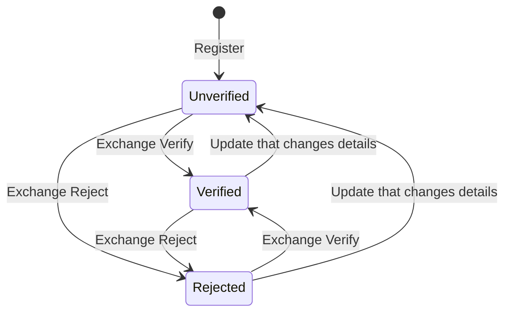

# 2. Party domain glossary

> The canonical dictionary of the **Party Reference Data Directory** service domain, as implemented at the end of Stage 1 (roadmap 1.1–1.21).
> Every member listed here exists in [`src/RimBank.Core/Party/PartyReferenceDataDirectory/`](../../src/RimBank.Core/Party/PartyReferenceDataDirectory/). BIAN names are the field names on the API; RimBank names are the names in the model.
> Text in quotation marks is quoted verbatim from the BIAN v14 OpenAPI file ([`PartyReferenceDataDirectory.yaml`](../../doc-0/release14.0.0/apis-iso20022_ext-ddd/oas3/yamls/PartyReferenceDataDirectory.yaml)).

## 2.0 How to read this glossary

**Status** of each element:

| Status | Meaning |
|---|---|
| Implemented | Recorded, validated, returned by Retrieve, available on HTTP and MCP |
| Not recorded | A BIAN field RimBank deliberately does not keep. A request that sends it is refused with a `…-field-not-supported` error, or (where stated) ignored |
| Deferred | A BIAN operation or channel not built in Stage 1 |

**Standards cited:**

| Standard | Used for |
|---|---|
| ISO 20022 data types `Max16Text`, `Max35Text`, `Max70Text`, `Max140Text`, `Max256Text`, `Max350Text`, `Max2048Text` | Maximum lengths of text fields |
| ISO 17442 | Legal Entity Identifier (LEI), with check digits per ISO 7064 MOD 97-10 |
| ISO 3166-1 alpha-2 | Country codes (nationality, residence, address country) ([ADR 0030](../adr/0030-iso-3166-country-codes.md)) |
| ISO 8601 | Dates and date-times on the wire |
| ITU-T E.164 | International telephone numbers. **E.164 is an ITU-T recommendation, not an ISO standard.** |
| RFC 9457 | Problem Details, the format of every error |
| ISO 4217 | Currency codes (used by later capabilities; not by Party) |

**PII classification** used below (RimBank's classification; protection at rest and in logs is roadmap 7.2):

| Class | Meaning |
|---|---|
| None | Not personal data |
| Personal | Identifies or describes a natural person (or can, combined with other data) |
| Sensitive | Personal data whose misuse carries elevated risk (political exposure, identity documents) |
| Special category | GDPR Art. 9 data. **RimBank keeps none** (Demographics `EthnicityReligion` is not modelled, [ADR 0024](../adr/0024-party-reference-data-directory-mapping.md)) |

**Partial update convention** (all Update operations): a field left out keeps its value, an empty value clears it, a given value replaces it. Every accepted Update is recorded as a business event, even when nothing changes.

---

## 2.1 Party Reference Data Directory Entry (Control Record)

**BIAN service domain definition:** "This service domain maintains a range of party reference information covering aspects including general reference details, contacts and associations and demographic information".

**BIAN Register description:** "Register a customer entity in the catalog".

**Business meaning.** One entry is the bank's single directory record for one **party**: a person or an organisation the bank deals with, whether a customer, a prospect, an employee, a branch or a counterparty. The entry is created once (Register), lives for as long as the bank knows the party, and holds three singleton parts (Demographics, Reference, BankRelations). Associations to other parties are separate records owned by the entry.

| Member (BIAN name) | Business definition | Type / format / standard | Rules | Business use | PII |
|---|---|---|---|---|---|
| Entry id (`partyreferencedatadirectoryid`) | The directory's identifier of the party, issued at Register | UUID version 7 (time-ordered) | Issued by RimBank, never chosen by the caller. Any other value is `shared.invalid-identifier` | The key every other capability uses to name the party ("PartyReference" in their events) | None (pseudonymous key) |
| `PartyType` | Whether the party is a natural person or an organisation. BIAN: "`Person` - Human entity, as distinguished from a corporate entity (which is sometimes referred to as an 'artificial person'). ISO20022"; "`Organisation` - Organised structure that is set up for a particular purpose. For example, a business, government body, department, charity, or financial institution. ISO20022" | Enum `Person` \| `Organisation` | Required at Register. May change on Update, except that an organisation holding corporate references cannot become a `Person` ([ADR 0034](../adr/0034-reference-corporate-and-officer-references.md)) | Drives which rules apply (officer is a person, branch is an organisation); product eligibility; KYC regime (individual vs entity) | None |
| `DirectoryEntryDate` with type `OpenDate` | When the party was entered in the directory | ISO 8601 date-time, UTC | Set by RimBank to the time of Register; caller's value ignored | Data lineage, retention periods | None |
| `DirectoryEntryDate` with type `RefreshDate` | When the entry was last confirmed or updated | ISO 8601 date-time, UTC | Set by RimBank at every accepted Update of the entry; absent until the first one | Periodic review of party data (data freshness KPIs) | None |
| `DemographicsId` (`demographicsid`) | Identifier of the entry's Demographics part | UUID v7 | Issued at Register; one per entry | Addresses the Demographics operations | None |
| `PartyReferenceId` (`referenceid`) | Identifier of the entry's Reference part | UUID v7 | Issued at Register; one per entry | Addresses the Reference operations | None |
| `BankRelationsId` (`bankrelationsid`) | Identifier of the entry's BankRelations part | UUID v7 | Issued at Register; one per entry | Addresses the BankRelations operations | None |
| Version (`ETag`) | The number of business events recorded on the entry | Integer, sent as a strong HTTP `ETag`; MCP `version` | Required as `If-Match` / `expectedVersion` on every change ([ADR 0027](../adr/0027-optimistic-concurrency-for-commands.md)) | Prevents lost updates when two users edit one party | None |
| `PartyReference` (on Register / Update) | BIAN's embedded party details | — | **Accepted and ignored**: details are recorded through Demographics and Reference ([ADR 0024](../adr/0024-party-reference-data-directory-mapping.md)) | — | — |

**Operations** ([ADR 0024](../adr/0024-party-reference-data-directory-mapping.md)):

| BIAN operation | Kind | HTTP | MCP tool | Status |
|---|---|---|---|---|
| Register | Command | `POST /PartyReferenceDataDirectory/Register` | `party_reference_data_directory_register` | Implemented |
| Update | Command | `PUT /PartyReferenceDataDirectory/{id}/Update` | `party_reference_data_directory_update` | Implemented |
| Retrieve | Query | `GET /PartyReferenceDataDirectory/{id}/Retrieve` | `party_reference_data_directory_retrieve` | Implemented |
| Control, Request, Execute, Exchange | Command | — | — | Deferred |

### Enumeration: `PartyType`

| Value | Meaning |
|---|---|
| `Person` | A natural person (an individual customer, an employee acting as relationship manager, a company officer) |
| `Organisation` | Any legal or organisational structure (a company, a charity, a government body, a bank branch or business unit) |

---

## 2.2 Demographics (Behavior Qualifier)

**BIAN description (Update):** "Update details about a customer's demographic entry".

**Business meaning.** Socio-economic and personal background the bank uses to understand and serve the party: classification, employment, education and servicing constraints. Unlike Reference, Demographics carries a **verification status**: the bank can verify or reject the details through the Exchange operation ([ADR 0028](../adr/0028-demographics-exchange-as-verification.md)).

| Member (BIAN name) | Business definition (BIAN, verbatim where quoted) | Type / format / standard | Rules | Business use | PII |
|---|---|---|---|---|---|
| `Socio-EconomicClassification` | "A bank defined classification of the socio-economic rating and prospect" | Text, ISO 20022 Max140Text | Trimmed; empty clears | Segmentation, product suitability, pricing | Personal |
| `Employment.PartyReference` | "Reference to the customer's employer (company name)" | Text, Max140Text | Free text, **not** checked against the directory | Affordability, income source (CDD), corporate-employee offers | Personal |
| `Employment.InvolvementReference` | The party's involvement with the employer (for example a job title) | Text, Max140Text | Free text; a given `Employment` replaces the whole employment | Same as above | Personal |
| `EmploymentHistory` | "Details of the customer's employment history (e.g. employer, dates, job position, salary)" | Text, Max2048Text | Trimmed; empty clears | Credit assessment input, source of wealth | Personal |
| `EducationHistory` | "Customer's education (e.g. academic institutions attended, duration, qualifications and certifications)" | Text, Max2048Text | Trimmed; empty clears | Segmentation (for example student offers) | Personal |
| `ServicingConstraints` | "Description of any known constraints on servicing the customer (sight, hearing, religious considerations)" | Text, Max2048Text | Trimmed; empty clears | Accessibility and fair treatment of vulnerable customers; channel routing | Personal (may reveal health; handle with care) |
| `VerificationStatus` | RimBank extension: whether the bank has checked the current details | Enum, see below | Starts `Unverified`; set by Exchange; reset to `Unverified` by an Update that changes the details | Data-quality controls, KYC evidence | None |
| `VerificationDate` | RimBank extension: when the details were last verified or rejected | ISO 8601 date-time, UTC | Set by Exchange; cleared when details change | Review cycles | None |
| `EthnicityReligion` | "Where needed to ensure the bank's handling of the relationship follows legal and regulatory requirements" | — | **Not modelled**: special-category data; ignored in requests, never returned | — | Special category |
| `ExchangeActionType` | RimBank extension field on Exchange: what the bank concludes | Enum `Verify` \| `Reject` | Required on Exchange; case-sensitive | Records the bank's verification decision | None |

**Operations:** `Demographics/Update` (command), `Demographics/Exchange` (command: verify or reject), `Demographics/Retrieve` (query). MCP: `…_update_demographics`, `…_exchange_demographics`, `…_retrieve_demographics`. All implemented.

### Enumeration: `DemographicsVerificationStatus`

| Value | Meaning |
|---|---|
| `Unverified` | The details have not been checked since they last changed (the initial state) |
| `Verified` | The bank has confirmed the current details |
| `Rejected` | The bank has found the current details not acceptable; they can be verified later |

### Enumeration: `ExchangeActionType`

| Value | Effect |
|---|---|
| `Verify` | Sets `VerificationStatus` to `Verified` and stamps `VerificationDate` |
| `Reject` | Sets `VerificationStatus` to `Rejected` and stamps `VerificationDate` |

An Exchange on a party with no recorded demographic details is refused (`party.demographics-not-recorded`).

---

## 2.3 Reference (Behavior Qualifier)

**BIAN description (Update):** "Update details about a reference entry for the customer".

**Business meaning.** The party's **identity and reference data**: identifiers, names, birth date, nationality and residency, addresses, contact points, legal standing, a government-issued document and, for organisations, references to the corporate customer, legal entity and a company officer. It is **what the party declares**, never the bank's assessment ([ADR 0032](../adr/0032-reference-legal-standing-and-documents.md)). Reference has no verification status. Fields were added in stages ([ADR 0029](../adr/0029-reference-fields-in-stages.md)).

### 2.3.1 Identifiers (roadmap 1.10)

| Member (BIAN path) | Business definition | Type / format / standard | Rules | Business use | PII |
|---|---|---|---|---|---|
| `GovernmentIssuedIdentityReference.TaxIdentificationNumber` | The number a tax authority assigned to the party (TIN) | Text, ISO 20022 Max35Text | Trimmed, not blank; country format **not** checked | FATCA / CRS reporting, tax withholding | Personal |
| `GovernmentIssuedIdentityReference.NationalRegistrationNumber` | The number a national registration authority assigned (for example a national identity number or company registration number) | Text, Max35Text | Same as TIN | Identification and verification (ID&V), de-duplication | Personal |
| `PartyLegalEntityReference.Identification` | The party's Legal Entity Identifier | ISO 17442 LEI: 20 characters, 18 alphanumerics + 2 check digits, upper-cased | Check digits must satisfy ISO 7064 MOD 97-10 | Entity identification for regulatory reporting (EMIR, MiFIR, AnaCredit-style), counterparty reference | None (identifies an entity) |

### 2.3.2 Names, birth date and residency (roadmap 1.18)

| Member (BIAN path) | Business definition | Type / format / standard | Rules | Business use | PII |
|---|---|---|---|---|---|
| `PartyFullLegalName` | The full legal name of the party | Text, Max140Text | Trimmed, not blank | Contracts, screening input, statements | Personal |
| `PartyNameSalutation` | The salutation the party prefers (for example `Ms`, `Dr`) | Text, Max35Text | Free text | Correspondence | Personal |
| `DateofBirth` | The party's date of birth | ISO 8601 calendar date (`YYYY-MM-DD`) | Between 1900-01-01 and today (UTC); a date-time is read as the date written, without time-zone conversion | Age-based eligibility (minors, seniors), ID&V | Personal |
| `Nationality.Code` | The party's nationality | ISO 3166-1 alpha-2 code | Officially assigned codes only | Sanctions/PEP context, CRS, FATCA (US persons) | Personal |
| `PartyCountryOfResidence.Code` | The country where the party lives (for an organisation: where its affairs are directed) | ISO 3166-1 alpha-2 | Same as nationality | Tax residency (CRS), cross-border rules | Personal |
| `ResidencyStatus.StatusDescription` | Whether the party is resident | Enum `Resident` \| `NonResident` | Any case on input | Exchange-control and tax treatment | Personal |
| `ResidencyStatus.StatusDateTime` | When the residency status was assigned | ISO 8601 date-time | Only with a status | Evidence for tax residency changes | Personal |

### 2.3.3 Addresses and contact points (roadmap 1.19, [ADR 0031](../adr/0031-reference-contact-points-and-addresses.md))

The three addresses share one structure, the ISO 20022 **postal address**:

| Address (BIAN field) | Business meaning |
|---|---|
| `ResidentialAddress` | Where a person lives |
| `PartyAddress` | The party's general (correspondence) address |
| `CorporateAddress` | An organisation's registered or business address |

| Postal address part | Format | Rule |
|---|---|---|
| `Department`, `SubDepartment` | Max70Text | Optional |
| `StreetName`, `StreetBuildingIdentification`, `BuildingName` | Max35Text | Optional |
| `Floor`, `PostOfficeBox`, `PostCodeIdentification` | Max16Text | Optional |
| `TownName` | Max35Text | **Required** |
| `Country.Code` | ISO 3166-1 alpha-2 | **Required** |

| Contact point (BIAN path) | Business definition (BIAN) | Format / standard | Rules | Business use | PII |
|---|---|---|---|---|---|
| `eMailAddress.EmailAddress` | "The given email address" | Max256Text, `local@domain.tld` | One `@`, no spaces or display name; kept as written | Servicing notifications, statements | Personal |
| `CellPhoneNumber.MobileNumber` | "Any given phone contact numbers" | ITU-T E.164 (`+` country code, 7–15 digits) | Spaces, hyphens and dots removed; stored normalised | SMS one-time passwords, servicing calls | Personal |
| `SocialNetworkContacts.URLAddress` | "Any given social network identifiers" | Absolute `https` URL, Max2048Text | Kept as written | Relationship context (for example corporate profile) | Personal |

Other `PostalAddress` and `ContactPoint` parts (address type, validity period, …) are not recorded.

### 2.3.4 Legal standing, political exposure and documents (roadmap 1.20, [ADR 0032](../adr/0032-reference-legal-standing-and-documents.md))

| Member (BIAN path) | Business definition | Type / format | Rules | Business use | PII |
|---|---|---|---|---|---|
| `PartyLegalStructure` | The legal form the party declares | Enum, see below | Read without regard to case, spaces or hyphens; answered in BIAN spelling | Entity KYC, product eligibility (for example business accounts), beneficial-ownership questionnaires | None |
| `PoliticalExposureType` | Whether the party declares itself a politically exposed person (PEP) | Enum, see below | — | Input to PEP screening and enhanced due diligence | Sensitive |
| `PoliticalExposureDescriptionRecord` | BIAN: "Detail of the customer's political exposure" | Max350Text | Only with a `Foreign` or `Domestic` exposure | EDD file | Sensitive |
| `CustomerSinceDate` | Since when the party has been a customer, as declared or migrated | ISO 8601 date | 1900-01-01 to today; not before `DateofBirth`; **not** compared with `OpenDate` (relationships can predate the directory, for example after migration) | Tenure-based offers, loyalty, risk scoring | None |
| `GovernmentIssuedDocumentDetails.PartyDocumentType` | BIAN: "Details about and extracted from government issued documents (e.g. driving license/passport details)" — the document category | Enum, see below | **Required** with a document | ID&V | Sensitive |
| `….DocumentReference.DocumentIdentification.IdentifierValue` | The document number (for example a passport number) | Max35Text | **Required**; no country format check | ID&V | Sensitive |
| `….DocumentReference.DocumentName` | The document's name (for example `Passport`) | Max140Text | Optional, free text | ID&V | None |
| `….DocumentValidityPeriod.FromDateTime` / `.ToDateTime` | The document's validity | ISO 8601 dates | `To` not before `From`. An expired document **can** be recorded: acting on expiry is a KYC concern | Periodic refresh triggers (in a KYC capability) | Personal |
| `DocumentDirectoryEntryInstanceReference.DocumentDirectoryEntryIdentification` | BIAN: "The document reference for associated documents" — where the scanned evidence is kept | Max35Text, opaque | Never resolved: BIAN Document Directory is not a RimBank capability | Link to the bank's document management system | None |

One government-issued document per party, because BIAN gives a single object.

### 2.3.5 Corporate and officer references (roadmap 1.21, [ADR 0034](../adr/0034-reference-corporate-and-officer-references.md))

Recorded **only on an organisation's** entry. Each reference is another registered entry of the directory, checked when it is set.

| Member (BIAN path) | Business definition (BIAN) | Type | Rules | Business use | PII |
|---|---|---|---|---|---|
| `CorporateCustomerReference.PartyReference` | "Reference to the corporate entity (Company for company customers)" | Entry id | Registered, not the party itself, of type `Organisation` | Linking an organisational unit or account-holding entity to the corporate customer | None |
| `CorporateCustomerLegalEntityReference.PartyReference` | "The legal entity reference (for company customers)" | Entry id | Same; may be the same entry as the corporate customer | Contracting legal entity for agreements | None |
| `CompanyOfficerReference.PartyReference` | "Reference to one or more identified company officers for a corporate customer" | Entry id | Registered, not the party itself, of type `Person`. One officer (BIAN gives one object) | Authorised signatory / director for entity KYC | None (key) |
| `CompanyOfficerRole` | The role of the officer (for example `Director`) | Max35Text | Only with an officer | Mandate and signing authority context | None |

### 2.3.6 Reference enumerations

**`ResidencyStatusCode`**

| Value | Meaning |
|---|---|
| `Resident` | Resident for the purposes of the bank's jurisdiction |
| `NonResident` | Not resident |

**`PartyLegalStructure`** (11 BIAN values plus `CharitableIncorporatedOrganisation`, which BIAN's description lists; the vocabulary is UK-oriented)

| Value (BIAN spelling) | Meaning |
|---|---|
| `Individual` | A natural person acting in a private capacity |
| `SoleTrader` (BIAN `Sole(SoleTrader)`) | An individual trading in their own name, with unlimited liability |
| `GeneralPartnership` | Partners share management and unlimited liability |
| `LimitedPartnership` | At least one general partner with unlimited liability and limited partners |
| `ScottishLimitedPartnership` | A limited partnership registered in Scotland, with its own legal personality |
| `LimitedLiabilityPartnership` | A partnership whose members have limited liability |
| `PrivateLimitedCompany` | A company limited by shares, not offered to the public |
| `PublicLimitedCompany` | A company limited by shares that may offer them to the public |
| `CommunityInterestCompany` | A limited company run for community benefit |
| `CharitableIncorporatedOrganisation` | An incorporated charity |
| `Charity` | A charitable organisation (unincorporated or other form) |
| `Co-Operative` | An organisation owned and run by its members |

**`PoliticalExposureType`** (BIAN `Politicalexposuretypevalues`)

| Value (stored / BIAN) | Meaning |
|---|---|
| `Foreign` / `Politicalexposureforeign` | Declares a prominent public function in a foreign country (or a close link to such a person) |
| `Domestic` / `Politicalexposuredomestic` | Declares a prominent public function in the bank's own country |
| `NoExposure` / `Nopoliticalexposure` | Declares no political exposure |

**`PartyDocumentType`** (BIAN `Partydocumenttypevalues`)

| Value | Meaning |
|---|---|
| `PersonalDocument` | A document that identifies a person (passport, identity card, driving licence) |
| `WorkDocument` | A document issued in a work context (work permit, employment document) |
| `CertificationDocument` | A certificate (for example certificate of incorporation, certified copy) |

**Operations:** `Reference/Update` (command), `Reference/Retrieve` (query). MCP: `…_update_reference`, `…_retrieve_reference`. Implemented. BIAN Reference parts not listed above are refused with `party.reference-field-not-supported`.

---

## 2.4 Associations (Behavior Qualifier, its own aggregate)

**BIAN description (Update):** "Update details about an association entry for the customer".
**BIAN `AssociateType`:** "The type of association with the party (e.g. familial or corporate, includes household associations, for corporations allowed users/buyers)".
**BIAN `AssociateReference`:** "Associated individuals of interest".

**Business meaning.** A **directed, dated relationship between two parties of the directory**: "the owner *type* the associate". A party can have many associations, and each one has its own identifier, version and lifecycle, which is why RimBank models Associations as a separate aggregate ([ADR 0024](../adr/0024-party-reference-data-directory-mapping.md), [ADR 0033](../adr/0033-party-associations.md)).

| Member (BIAN path) | Business definition | Type / format | Rules | Business use | PII |
|---|---|---|---|---|---|
| Association id (`associationsid`) | Identifier of the association | UUID v7 | Issued at Register | Addresses Update / Retrieve | None |
| Owner | The entry the association belongs to (the path's `partyreferencedatadirectoryid`) | Entry id | Must be registered; never changes | — | None |
| `AssociateReference.PartyReference` | The other party | Entry id | Required at Register; registered; not the owner; **never changes** (a different associate is a new association) | Household, group and mandate structures | None (key) |
| `AssociateType` | The kind of relationship | Enum `PartyRelationshipType` | Required at Register; cannot be cleared | Drives KYC (who must be identified), mandates, consolidated exposure | None |
| `AssociationValidFromToDate.FromDateTime` / `.ToDateTime` | When the relationship starts / ends | ISO 8601 date-time, stored UTC | At least one bound; `From` ≤ `To`. Ending an association = recording `ToDateTime`; no "active" flag is derived | Historic structure ("who was director on date X") | None |

**Not recorded** (refused with `party.association-field-not-supported`): `EmployeeReference`, `AssociateObligationorDependencyDescription`, `PreferredBeneficiary`, `ProxyRepresentativePowerofAttorneyReference`, `ProductInstanceReference`, `ProductInstanseInvolvementReference` (BIAN spelling), `AssociateReference.InvolvementReference`. A power of attorney is recordable as the type `PartyIsThePowerOfAttorneyForParty`.

### Enumeration: `PartyRelationshipType`

Read as "**owner** *relationship* **associate**". The meanings are RimBank's reading of the BIAN names.

| Value | Meaning | Typical use |
|---|---|---|
| `PartyIsParentOfParty` | The owner is the parent of the associate (corporate parent, or parent in a family) | Group structures, consolidated exposure |
| `PartyIsSubsidiaryOfParty` | The owner is a subsidiary of the associate | Group structures |
| `PartyIsCertifiedByParty` | The owner is certified by the associate (for example by an auditor or certification body) | Entity due diligence |
| `PartyIsMarriedToParty` | The owner is married to the associate | Household view, joint products |
| `PartyActsOnBehalfOfParty` | The owner acts on behalf of the associate (agent, authorised user) | Mandates, delegated access |
| `PartyIsContactPointForParty` | The owner is the contact person for the associate | Corporate servicing |
| `PartyIsTrustedByParty` | The owner is a trusted contact of the associate | Vulnerable-customer protection |
| `PartyIsThePowerOfAttorneyForParty` | The owner holds a power of attorney for the associate | Legal representation |
| `PartyReceivesBenefitsFromAParty` | The owner benefits from the associate (beneficiary) | Beneficial ownership, trusts, insurance |

**Operations:** `Associations/Register`, `Associations/Update` (commands), `Associations/Retrieve` (query). MCP: `…_register_associations`, `…_update_associations`, `…_retrieve_associations`. Implemented.

---

## 2.5 BankRelations (Behavior Qualifier)

**BIAN `BankRelationType`:** "The type of relationship (e.g. relationship manager)".
**BIAN `BusinessUnitEmployeeReference`:** "Reference to the associated employee or unit".

**Business meaning.** The party's **servicing relationship with the bank itself**: who in the bank (an employee) or which unit (a branch or business unit) looks after the party, since when, until when, and in which lifecycle state. One relationship per entry in Stage 1 ([ADR 0035](../adr/0035-party-bank-relations.md)). The employee or unit is itself a registered party of the directory.

| Member (BIAN path) | Business definition | Type / format | Rules | Business use | PII |
|---|---|---|---|---|---|
| `BankRelationType` | The role the bank plays for the party | Enum, see below | Required whenever an employee/unit is recorded | Servicing model, portfolio assignment | None |
| `BusinessUnitEmployeeReference.PartyReference` | The employee or unit | Entry id | Registered; not the party itself; a `Person` for employee roles, an `Organisation` for unit roles | Routing, RM dashboards, commissions | None (key) |
| `BankRelationReference.RelationshipStartDate.DateTimeContent` | When the relationship started | ISO 8601, stored UTC | — | Portfolio history | None |
| `BankRelationReference.RelationshipEndDate.DateTimeContent` | When the relationship ended | ISO 8601, stored UTC | Not before the start | Hand-over tracking | None |
| `BankRelationReference.RelationshipLifecycleStatus.StatusDescription` | The relationship's state | Enum, see below | Declared, not derived from dates (`Ended` does not require an end date) | Servicing workflow | None |

### Enumeration: `BankRelationType`

| Value | Referenced party type | Meaning |
|---|---|---|
| `RelationshipManager` | Person | The employee who owns the commercial relationship |
| `AccountOfficer` | Person | The employee responsible for the party's accounts / credit file |
| `ServicingBranch` | Organisation | The branch that services the party |
| `ServicingBusinessUnit` | Organisation | The business unit (for example private banking, SME desk) that services the party |

### Enumeration: `BankRelationLifecycleStatus`

| Value | Meaning |
|---|---|
| `Active` | The relationship is in force |
| `Suspended` | Temporarily not in force (for example during a hand-over or an investigation) |
| `Ended` | The relationship is over |

**Operations:** `BankRelations/Update` (command), `BankRelations/Retrieve` (query). MCP: `…_update_bank_relations`, `…_retrieve_bank_relations`. Implemented.

---

## 2.6 Business events

### 2.6.1 Domain events (internal history of the record)

These are the facts recorded in the party's event stream. They form the audit trail and are never shared with other capabilities directly.

| Event | Recorded when | Carries |
|---|---|---|
| `PartyRegistered` | A party is registered | Entry id, party type, open date, the three BQ ids |
| `PartyReferenceDataDirectoryEntryUpdated` | The entry is updated | Entry id, party type, refresh date |
| `DemographicsUpdated` | Demographics are updated | The full resulting details and their verification status/date |
| `DemographicsExchanged` | Demographics are verified or rejected | Verification status, verification date |
| `PartyReferenceUpdated` | Reference is updated | The full resulting Reference |
| `BankRelationsUpdated` | BankRelations are updated | The full resulting BankRelations |
| `PartyAssociationRegistered` | An association is registered | Association id, owner, associate, type, validity period |
| `PartyAssociationUpdated` | An association is updated | Association id, type, validity period |

### 2.6.2 Integration events (published to the rest of the bank)

Published through a transactional outbox, versioned, and pinned by a schema contract test ([ADR 0036](../adr/0036-party-published-language.md)).

| Integration event | BIAN channel | Message identity | Published on |
|---|---|---|---|
| `PartyReferenceDataDirectoryEntryCreated` | `PartyReferenceDataDirectoryEntry/Created` | `party-reference-data-directory-entry.created.v1` | Register |
| `PartyReferenceDataDirectoryEntryUpdated` | `PartyReferenceDataDirectoryEntry/Updated` | `party-reference-data-directory-entry.updated.v1` | Entry Update |

Both carry the same payload:

| Member | Meaning |
|---|---|
| `EventId` | Unique id of the event (UUID v7); consumers use it to de-duplicate |
| `OccurredAt` | When the business fact happened |
| `PartyReferenceDataDirectoryEntryId` | The party's directory id |
| `Version` | The entry's version after the fact (lets consumers ignore out-of-order deliveries) |
| `PartyType` | `Person` or `Organisation` |
| `DirectoryEntryDateType` | `OpenDate` (Created) or `RefreshDate` (Updated) |
| `DirectoryEntryDate` | The date named by the type |

**Deferred:** the eight BIAN Behavior Qualifier channels (`Demographics/Created`, `Reference/Updated`, …). Consumers that need demographic or reference data cannot yet receive it by event.

---

## 2.7 Business error codes

Every refusal is an RFC 9457 Problem Details document with `type` `urn:rimbank:problem:party:<code>` and the same content on HTTP and MCP.

| Code | HTTP | Business meaning |
|---|---|---|
| `party.party-type-required` | 400 | Register without a party type |
| `party.party-type-invalid` | 400 | A party type other than Person or Organisation |
| `party.party-already-registered` | 409 | The entry already exists (only a replayed decision meets it) |
| `party.party-not-found` | 404 | No party with this id in the directory |
| `party.behavior-qualifier-not-found` | 404 | The Demographics, Reference or BankRelations id does not belong to this party |
| `party.version-conflict` | 409 | Someone changed the party since you read it; retrieve and retry |
| `party.demographics-invalid` | 400 | A demographic detail is too long |
| `party.demographics-not-recorded` | 422 | Nothing to verify or reject: record demographics first |
| `party.exchange-action-type-required` | 400 | Exchange without `Verify` / `Reject` |
| `party.exchange-action-type-invalid` | 400 | Exchange action other than `Verify` / `Reject` |
| `party.reference-invalid` | 400 | A reference value is malformed or breaks a cross-field rule (birth date in the future, customer-since before birth, description without exposure, officer role without officer, …) |
| `party.reference-field-not-supported` | 400 | A BIAN Reference field RimBank does not record; nothing was updated |
| `party.corporate-references-need-organisation` | 422 | Corporate / officer references only on an organisation; or an organisation with them cannot become a person |
| `party.self-reference` | 422 | A reference names the party itself |
| `party.referenced-party-not-registered` | 422 | A referenced party is not in the directory: register it first |
| `party.referenced-party-type-mismatch` | 422 | The referenced party has the wrong type (officer must be a person, branch an organisation, …) |
| `party.association-invalid` | 400 | Missing or malformed associate, type or validity period |
| `party.association-field-not-supported` | 400 | A BIAN Associations field RimBank does not record |
| `party.association-not-found` | 404 | No such association for this party |
| `party.association-already-registered` | 409 | The association already exists (replay only) |
| `party.self-association` | 422 | A party cannot be associated with itself |
| `party.associate-not-registered` | 422 | The associate is not in the directory |
| `party.associate-cannot-change` | 422 | An association's associate never changes: register a new association |
| `party.bank-relations-invalid` | 400 | Malformed value, employee/unit without a type, or end before start |
| `party.bank-relations-field-not-supported` | 400 | A BIAN BankRelations part RimBank does not record |

Shared codes that every capability uses include `shared.unauthenticated` (401), `shared.forbidden` (403), `shared.invalid-identifier` (400), `shared.idempotency-key-missing` / `-invalid` (400), `shared.idempotency-key-reused` / `-in-use` (409), `shared.if-match-required` (428), `shared.if-match-invalid` (400), `shared.invalid-country` (400) and `shared.unexpected` (500).

Next: [entity relationships](03-entity-relationships.md).
