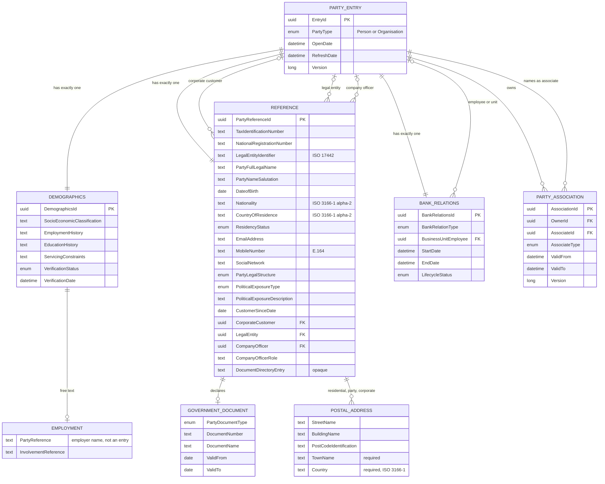
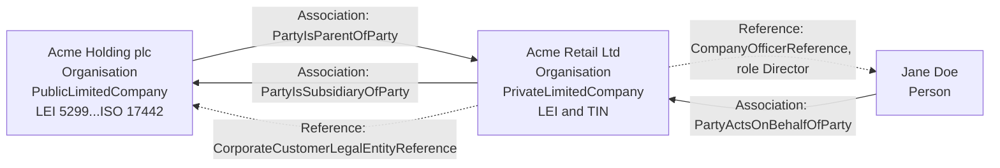
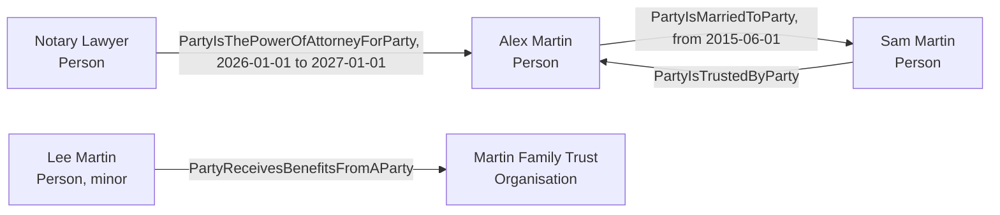
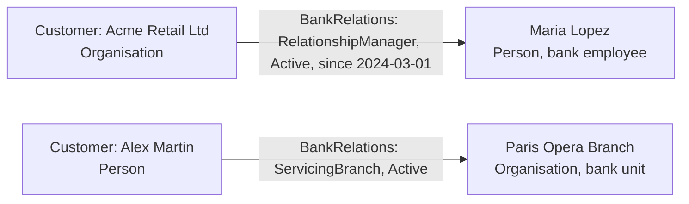
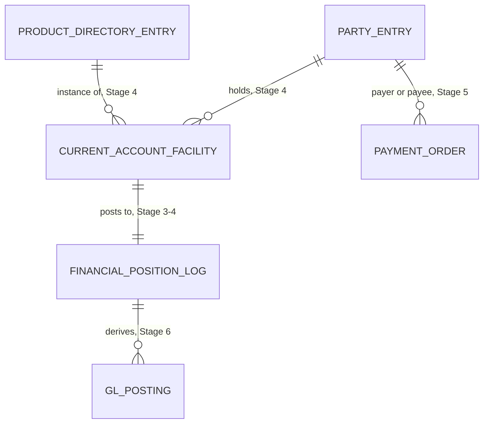

# 3. Entity relationships

> How the parts of the Party Reference Data Directory relate to each other and how parties relate to other parties and to the bank. Member-level definitions are in the [glossary](02-party-domain-glossary.md). The physical/technical data model is in the architecture documentation ([`docs/architecture/`](../architecture/)).

## 3.1 Business entity-relationship model

Notes on the model:

- **Demographics, Reference and BankRelations** are *parts of the entry* (one each, created empty at Register, same version and history as the entry). They have their own ids only because BIAN routes address them by id.
- **Party Association** is a *record of its own*: many per party, own id, own version, own history ([ADR 0024](../adr/0024-party-reference-data-directory-mapping.md)). It is owned by one entry and names another.
- **Employment** in Demographics is **free text**: the employer is *not* checked against the directory. Use an association or a corporate reference when the employer must be a known party.
- **Document directory entry** is an opaque reference to the bank's document store; it is never resolved by RimBank.

## 3.2 Cardinalities and constraining rules

| Relationship | Cardinality | Rules (checked when recorded) | Source |
|---|---|---|---|
| Entry → Demographics / Reference / BankRelations | 1 : 1 each | A BQ id that is not the entry's is `party.behavior-qualifier-not-found` | [ADR 0024](../adr/0024-party-reference-data-directory-mapping.md) |
| Entry (owner) → Association | 1 : 0..n | Owner must be registered (`party.party-not-found`). Same owner, associate and type may be registered twice (for example two periods) | [ADR 0033](../adr/0033-party-associations.md) |
| Association → associate entry | n : 1 | Registered (`party.associate-not-registered`); not the owner (`party.self-association`); never changes (`party.associate-cannot-change`). Any party type | [ADR 0033](../adr/0033-party-associations.md) |
| Reference → corporate customer | 0..1 | Only on an `Organisation` entry; target registered, not self, an `Organisation` | [ADR 0034](../adr/0034-reference-corporate-and-officer-references.md) |
| Reference → legal entity | 0..1 | Same; may be the same entry as the corporate customer | [ADR 0034](../adr/0034-reference-corporate-and-officer-references.md) |
| Reference → company officer | 0..1 | Only on an `Organisation`; target a `Person`; a `CompanyOfficerRole` needs an officer | [ADR 0034](../adr/0034-reference-corporate-and-officer-references.md) |
| BankRelations → employee or unit | 0..1 | Needs a `BankRelationType`; `RelationshipManager` / `AccountOfficer` → a `Person`; `ServicingBranch` / `ServicingBusinessUnit` → an `Organisation`; not self; registered | [ADR 0035](../adr/0035-party-bank-relations.md) |
| Entry `PartyType` change | — | An organisation with corporate references cannot become a `Person` until they are cleared | [ADR 0034](../adr/0034-reference-corporate-and-officer-references.md) |

**Accepted drift.** Rules about a *referenced* party are checked when the reference is recorded. If that party later changes its own type, references pointing at it are not re-checked (that would require a cross-record index on the write side). Consumers that need the current type read the referenced entry.

**No derived "active" flags.** Validity periods and relationship dates are never compared with today by RimBank. A consumer compares them with its own business date.

## 3.3 Three kinds of links — which one to use

| | **Association** | **Corporate / officer reference** (in Reference) | **Bank relation** (BankRelations) |
|---|---|---|---|
| Connects | Party ↔ party | Organisation → its corporate customer, legal entity, one officer | Party ↔ the bank (an employee or unit, itself a party) |
| How many | Many per party | One of each per organisation | One per party (Stage 1) |
| Own lifecycle | Yes: own id, version, Register / Update / Retrieve | No: part of the entry's Reference | No: part of the entry |
| Dated | Validity period (from / to) | No | Start date, end date, lifecycle status |
| Typical question | "Who is married to whom? Who holds power of attorney? Who is the parent company?" | "Which legal entity contracts for this corporate customer? Who is its director?" | "Who is this customer's relationship manager? Which branch services them?" |
| BIAN source | Associations BQ | Reference BQ (`CorporateCustomerReference`, `CorporateCustomerLegalEntityReference`, `CompanyOfficerReference`) | BankRelations BQ |

Rule of thumb: if the link has its own history or there may be several, use an **Association**. If it is the organisation's single statutory reference data, use **Reference**. If the other side is the bank's own staff or unit, use **BankRelations**.

## 3.4 Worked example A — corporate group

*Acme Holding plc* owns *Acme Retail Ltd*. Acme Retail is the bank's corporate customer; Jane Doe is its director.

How it is recorded:

1. Register three entries (two `Organisation`, one `Person`).
2. On Acme Retail's Reference: LEI, TIN, `PartyLegalStructure = PrivateLimitedCompany`, `CompanyOfficerReference = Jane`, `CompanyOfficerRole = Director`, and the legal entity reference to the holding if the holding is the contracting entity.
3. Associations: the holding registers `PartyIsParentOfParty` → Retail; Retail may register the inverse `PartyIsSubsidiaryOfParty` → Holding. **Inverses are not automatic**: each direction is its own association owned by its own party ([ADR 0033](../adr/0033-party-associations.md)).
4. Jane can also be linked by association (`PartyActsOnBehalfOfParty`) when the mandate needs a validity period or there are several signatories (the Reference holds only one officer).

Business value: entity KYC (who controls, who signs), group exposure, LEI-based regulatory reporting.

## 3.5 Worked example B — household and representation

- Marriage and power of attorney are dated associations; the power of attorney **ends** when its `ToDateTime` passes, without an update.
- The beneficiary link supports beneficial-ownership and trust due diligence.
- "Sam is a trusted contact of Alex" supports vulnerable-customer procedures.
- RimBank does **not** record the obligations, the preferred beneficiary details or the proxy object of BIAN Associations (refused, [ADR 0033](../adr/0033-party-associations.md)).

## 3.6 Worked example C — servicing model

The bank's own staff and units are parties of the directory too.

- A `RelationshipManager` or `AccountOfficer` must reference a `Person`; a `ServicingBranch` or `ServicingBusinessUnit` an `Organisation`. A mismatch is `party.referenced-party-type-mismatch`.
- A relationship that changes hands is updated (new reference, new start date) — the previous one stays in the party's event history.
- A party with **both** a relationship manager and a servicing branch needs more than one bank relation; that is a planned change of model (its own aggregate, a future ADR, [ADR 0035](../adr/0035-party-bank-relations.md)).

## 3.7 How Party relates to the planned capabilities

These links cross capability boundaries, so they are **not** foreign keys: each consumer keeps its own minimal copy of "party is known and active", fed by Party's events, and never reads Party's data store ([tech-stack §8.4](../../specs/tech-stack.md#84-read-models-across-contexts-loose-coupling)).

Next: [value streams](04-value-streams.md).
