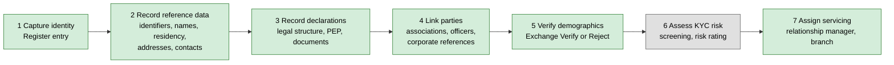
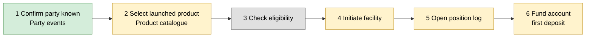
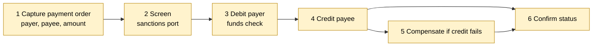
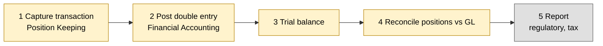
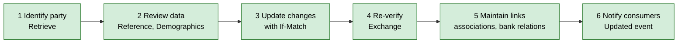

# 4. Business value streams

> **Status of this document.** The value streams below are **RimBank's business modelling**. They follow value-stream practice (a trigger, a sequence of value-adding stages, a stakeholder who receives the value) and BIAN's business-scenario thinking (a scenario is a sequence of service-domain interactions), but BIAN v14 does not publish them in this form. The service domains named at each stage are BIAN v14 service domains; the RimBank status comes from the [roadmap](../../specs/roadmap.md).

## 4.0 Overview

| # | Value stream | Triggering stakeholder | Value delivered | RimBank coverage today |
|---|---|---|---|---|
| VS1 | **Onboard a party** (Know your customer) | Prospect, corporate client, bank staff | A known, identified party the bank may do business with | Party data capture implemented; KYC assessment not in scope (backlog) |
| VS2 | **Open a product** (current account) | Customer | A usable account on agreed terms | Party implemented; Product (Stage 2), Position Keeping (3), Current Account (4) planned |
| VS3 | **Move money** (internal transfer) | Customer, corporate treasurer | Funds moved once, correctly, with status | Planned (Stages 4–5) |
| VS4 | **Record and report** (books, reconciliation) | Finance, regulator, auditor | A ledger that reconciles with customer positions | Planned (Stage 6) |
| VS5 | **Service the relationship** | Customer, relationship manager, AI assistant | Up-to-date data, the right person servicing the customer | Party BankRelations, Associations, Update and MCP implemented |

Legend used in the stage diagrams: **green** = implemented in RimBank, **amber** = planned on the roadmap, **grey** = outside RimBank (another system or a backlog capability).

---

## VS1 — Onboard a party (Know your customer)

| | |
|---|---|
| **Trigger** | A prospect applies (branch, web, partner, agent), or the bank needs to record a counterparty, employee or unit |
| **Stakeholders** | Prospect / customer; onboarding officer; compliance (KYC/AML); relationship manager |
| **Value proposition** | "We know who you are, we hold your data once, correctly, and you never have to repeat it." |
| **End state** | A registered party with identity, contact, legal-standing and relationship data, ready for KYC decisioning and product opening |

| Stage | BIAN service domain(s) | RimBank operation / status | Party data used |
|---|---|---|---|
| 1 Capture identity | Party Reference Data Directory | `Register` — implemented | `PartyType` |
| 2 Record reference data | Party Reference Data Directory | `Reference/Update` — implemented | TIN, national registration number, LEI, full legal name, date of birth, nationality, residence, addresses, email, mobile |
| 3 Record declarations | Party Reference Data Directory (+ Document Directory, not in RimBank) | `Reference/Update` — implemented | Legal structure, political exposure, customer-since, government-issued document, document directory reference |
| 4 Link parties | Party Reference Data Directory | `Associations/Register`, `Reference/Update` (officer) — implemented | Associations, corporate / officer references |
| 5 Verify demographics | Party Reference Data Directory | `Demographics/Update`, `Demographics/Exchange` — implemented | Demographics and verification status |
| 6 Assess KYC risk | Party Lifecycle Management, Regulatory Compliance, Fraud Evaluation | **Not in RimBank** (Party Lifecycle Management is Stage 8+ backlog) | Consumes declared values via Party events — never reads the directory ([ADR 0032](../adr/0032-reference-legal-standing-and-documents.md)) |
| 7 Assign servicing | Party Reference Data Directory | `BankRelations/Update` — implemented | Bank relation type, employee or unit |

BIAN definition of the downstream KYC capability (verbatim): *Party Lifecycle Management* — "This service domain tracks the state of a party relationship with the bank from the initial checks made during the establishment of a new party connection and subsequently maintained as necessary over the duration of the relationship. The checks and the maintenance requirements will vary by party type and jurisdiction."

**Value measures (KPIs):** time from application to registered party; first-time-right rate (share of Reference updates refused with `party.reference-invalid`); share of parties with verified demographics; duplicate-party rate; share of organisations with LEI and officer recorded.

---

## VS2 — Open a product (current account)

| | |
|---|---|
| **Trigger** | A registered customer asks for a current account |
| **Stakeholders** | Customer; sales/servicing channel; product management |
| **Value proposition** | "Open an account in minutes, on the published terms, with a correct balance from day one." |
| **End state** | An initiated current-account facility with its own position log |

| Stage | BIAN service domain(s) | RimBank status | How Party enables it |
|---|---|---|---|
| 1 Confirm party known | Party Reference Data Directory → Current Account | Party events implemented; Current Account's subscription is roadmap 4.1–4.2 | Current Account keeps its own "known party" copy from `Created` / `Updated` events — no call to Party |
| 2 Select launched product | Product Directory | Roadmap 2.4–2.5 | — |
| 3 Check eligibility | Customer Product and Service Eligibility | Backlog (Stage 8+) | Party type, date of birth, residency are typical inputs (requires the deferred BQ channels) |
| 4 Initiate facility | Current Account | Roadmap 4.3–4.4 (requires a known party and a launched product) | Party id is the facility holder |
| 5 Open position log | Position Keeping | Roadmap 4.5 | — |
| 6 Fund account | Current Account, Position Keeping | Roadmap 4.6 | — |

**Value measures:** time to open; share of openings refused for unknown party or product; abandoned applications.

---

## VS3 — Move money (internal book transfer)

| | |
|---|---|
| **Trigger** | A customer orders a transfer between two accounts held at the bank |
| **Stakeholders** | Payer, payee, operations, compliance |
| **Value proposition** | "Your money moves exactly once, is never lost, and you can see where it is." |
| **End state** | Debit and credit executed (or the debit reversed), payment order status final |

| Stage | BIAN service domain(s) | RimBank status |
|---|---|---|
| 1 Capture order | Payment Order Initiation | Roadmap 5.1 |
| 2 Screen | Payment Order Initiation (Compliance BQ) | Roadmap 5.2 (allow-list stub; no real screening engine) |
| 3 Debit payer | Current Account, Position Keeping | Roadmap 4.7, 5.3–5.4 (funds checked on authoritative write-side balance) |
| 4 Credit payee | Current Account, Position Keeping | Roadmap 5.4 |
| 5 Compensate | Payment Order Initiation, Current Account | Roadmap 5.3 (reversal request) |
| 6 Confirm | Payment Order Initiation (Confirmation BQ) | Roadmap 5.5 |

**How Party enables it:** the payer and payee are parties; their names and identifiers are the inputs a sanctions-screening port needs; a party's lifecycle (for example an ended relationship) can block execution in later phases.

**Value measures:** straight-through-processing rate; duplicate executions (target: zero, enforced by idempotency); compensations per thousand transfers; time to final status.

---

## VS4 — Record and report

| | |
|---|---|
| **Trigger** | Every captured financial transaction; period end |
| **Stakeholders** | Finance, risk, regulators, auditors |
| **Value proposition** | "The books are complete, balanced and reconcile with every customer position." |
| **End state** | Posted GL, trial balance, reconciled positions, regulatory reports |

| Stage | BIAN service domain(s) | RimBank status |
|---|---|---|
| 1 Capture | Position Keeping | Roadmap 3.3, 3.7 |
| 2 Post | Financial Accounting | Roadmap 6.2 (property test: debits = credits) |
| 3 Trial balance | Financial Accounting | Roadmap 6.3 |
| 4 Reconcile | Account Reconciliation | Roadmap 6.4 (own context, compared at matching event checkpoints) |
| 5 Report | Regulatory Reporting, Customer Tax Handling | Backlog (Stage 8+) |

**How Party enables it:** regulatory and tax reports need the party's identifiers (LEI, TIN), residency and nationality (for example CRS / FATCA), and legal structure. Those come from the Reference BQ — today held in Party; their publication by event is a deferred BIAN channel.

**Value measures:** unreconciled breaks; time to close; report resubmissions.

---

## VS5 — Service the relationship

| | |
|---|---|
| **Trigger** | A customer contacts the bank, data changes, or a periodic review falls due |
| **Stakeholders** | Customer, relationship manager, contact centre, AI assistant |
| **Value proposition** | "The person (or agent) serving you knows who you are, who you are linked to, and who looks after you." |
| **End state** | Current party data, correct servicing assignment, change history kept |

| Stage | RimBank operation (HTTP / MCP) | Status |
|---|---|---|
| 1 Identify | `Retrieve` / `party_reference_data_directory_retrieve` | Implemented |
| 2 Review | `Reference/Retrieve`, `Demographics/Retrieve` | Implemented |
| 3 Update | `Reference/Update`, `Demographics/Update`, entry `Update` (refresh date) | Implemented — stale data is refused with `party.version-conflict` |
| 4 Re-verify | `Demographics/Exchange` | Implemented — any change resets the status to `Unverified` |
| 5 Maintain links | `Associations/Register` / `Update`, `BankRelations/Update` | Implemented |
| 6 Notify | `PartyReferenceDataDirectoryEntry/Updated` | Implemented for the entry; BQ channels deferred |

BIAN definition of the related CRM capability (verbatim): *Customer Relationship Management* — "This service domain develops and executes a customer plan to maintain and build a customer relationship. Activities include ongoing customer contact, tracking internal and external events and activity of interest and relevance, product and service matching and sales, processing ad-hoc queries, trouble shooting and issue resolution including the initial phases of troubled account recovery". It is not on RimBank's roadmap; a CRM system consumes Party's events.

**Value measures:** data freshness (age of `RefreshDate`); share of parties with an `Active` bank relation; lost-update incidents (target: zero); share of interactions handled by an AI assistant without hand-off.

---

## 4.6 Value stream × service domain matrix

● = the service domain contributes a stage; status in brackets: **I** implemented, **P** planned (roadmap stage), **B** backlog, **X** outside RimBank.

| Service domain | VS1 Onboard | VS2 Open product | VS3 Move money | VS4 Record & report | VS5 Service |
|---|---|---|---|---|---|
| Party Reference Data Directory (I) | ● | ● | ● (payer/payee) | ● (identifiers) | ● |
| Party Lifecycle Management (B) | ● | | | | ● |
| Product Directory (P2) | | ● | | | |
| Customer Product and Service Eligibility (B) | | ● | | | |
| Position Keeping (P3) | | ● | ● | ● | |
| Current Account (P4) | | ● | ● | | ● |
| Payment Order Initiation (P5) | | | ● | | |
| Financial Accounting (P6) | | | | ● | |
| Account Reconciliation (P6.4) | | | | ● | |
| Regulatory Reporting (B) | ● | | | ● | |
| Customer Relationship Management (X) | | | | | ● |
| Document Directory (X) | ● | | | | |

Next: [banking use cases](05-banking-use-cases.md).
