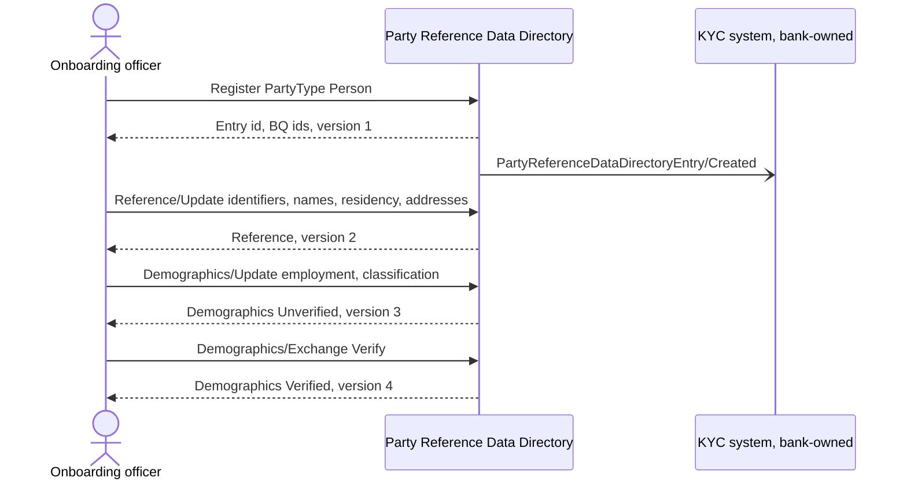
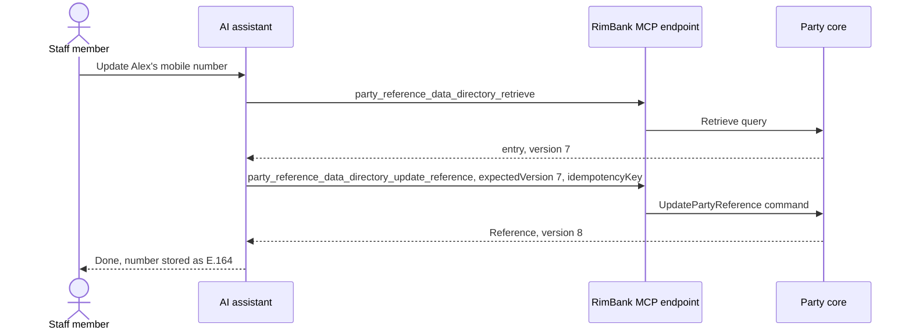

# 5. Banking use cases and integration guide

> Concrete ways a bank uses the Party Reference Data Directory as implemented today, what each one delivers, and what stays out of scope. Field definitions are in the [glossary](02-party-domain-glossary.md); relationships in [entity relationships](03-entity-relationships.md).

## 5.0 The scope line

The directory **records what the party declares and what the bank has decided to keep as reference**. It does **not** assess, screen, score or decide ([ADR 0032](../adr/0032-reference-legal-standing-and-documents.md), [mission, non-goals](../../specs/mission.md#non-goals)):

| RimBank Party does | RimBank Party does not |
|---|---|
| Hold identifiers, names, residency, addresses, contacts, legal structure, PEP declaration, one government-issued document reference | Screen against sanctions or PEP lists |
| Validate format and consistency (LEI check digits, ISO 3166 codes, E.164, dates, cross-field rules) | Validate a TIN or national number against a country's registry format |
| Keep a full, dated history of every change (event-sourced) | Compute a KYC risk rating, a refresh schedule or an "expired document" alert |
| Record the bank's verification of demographics (Verify / Reject) | Store scanned documents (it stores an opaque reference to the bank's document directory) |
| Link parties to parties and to bank staff and units | De-duplicate or match parties |
| Publish `Created` / `Updated` events of the entry | Publish the Behavior Qualifier events (deferred) |

All operations below are available on HTTP and as MCP tools with identical rules and errors. Every command requires an `Idempotency-Key`; every change of an existing record requires `If-Match` (MCP: `expectedVersion`).

---

## UC1 — KYC / CDD onboarding data capture

| | |
|---|---|
| **Actor** | Onboarding officer, digital onboarding journey |
| **Goal** | Capture everything customer due diligence needs, once, in a structured, auditable record |
| **Operations** | `Register` → `Reference/Update` → `Demographics/Update` → `Demographics/Exchange` |
| **MCP tools** | `party_reference_data_directory_register`, `…_update_reference`, `…_update_demographics`, `…_exchange_demographics` |
| **Data** | `PartyType`; TIN, national registration number, LEI; full legal name, date of birth; nationality, residence, residency status; residential / party / corporate address; email, mobile; legal structure; document details; employment, socio-economic classification |
| **Business value** | Structured, validated CDD file; every value traceable to who recorded it and when; no duplicate entry on a retried submission (idempotency) |
| **Out of scope / deferred** | Identity verification against external sources; document image storage; the KYC decision (Party Lifecycle Management, Stage 8+ backlog) |

## UC2 — PEP declaration as screening input

| | |
|---|---|
| **Actor** | Customer (self-declaration), compliance analyst |
| **Goal** | Record whether the party declares a political exposure and its description |
| **Operations** | `Reference/Update` (`PoliticalExposureType`, `PoliticalExposureDescriptionRecord`) |
| **Data** | `Foreign`, `Domestic` or `NoExposure`; description up to 350 characters, only with an exposure |
| **Business value** | A clean, consistent declaration (no description without an exposure; no contradictory leftovers after partial updates) feeding enhanced due diligence |
| **Out of scope** | Screening against PEP lists, the bank's own PEP conclusion, EDD workflow — these belong to a KYC capability that would consume the declaration by event |

## UC3 — Beneficial ownership and corporate structures

| | |
|---|---|
| **Actor** | Corporate onboarding team, credit risk |
| **Goal** | Model who owns, controls and represents an organisation |
| **Operations** | `Register` (each person and organisation), `Reference/Update` (corporate customer, legal entity, company officer and role), `Associations/Register` / `Update` |
| **Data** | LEI, legal structure; `CorporateCustomerReference`, `CorporateCustomerLegalEntityReference`, `CompanyOfficerReference` (a `Person`), `CompanyOfficerRole`; associations `PartyIsParentOfParty`, `PartyIsSubsidiaryOfParty`, `PartyActsOnBehalfOfParty`, `PartyReceivesBenefitsFromAParty` with validity periods |
| **Business value** | Group and control structures built from **registered** parties only (no dangling names), with type rules enforced (an officer is a person, a corporate customer an organisation) and history preserved |
| **Out of scope** | Ownership percentages and control thresholds (not BIAN Party fields RimBank records); the `AssociateObligationorDependencyDescription` and `PreferredBeneficiary` objects (refused, [ADR 0033](../adr/0033-party-associations.md)); automatic inverse associations |

## UC4 — FATCA / CRS tax-residency inputs

| | |
|---|---|
| **Actor** | Tax operations, regulatory reporting |
| **Goal** | Hold the indicators that drive automatic exchange of information |
| **Operations** | `Reference/Update`, `Reference/Retrieve` |
| **Data** | `TaxIdentificationNumber` (Max35Text), `Nationality.Code` and `PartyCountryOfResidence.Code` (ISO 3166-1 alpha-2), `ResidencyStatus` with its date, addresses with country |
| **Business value** | Valid country codes everywhere; one TIN per party; dated residency status for evidence |
| **Out of scope / limits** | One TIN only (no TIN per jurisdiction); no self-certification form; no reportable-account determination; reporting itself (Customer Tax Handling / Regulatory Reporting, backlog). The Reference BQ channel that would carry these values by event is deferred |

## UC5 — Relationship management and servicing assignment

| | |
|---|---|
| **Actor** | Head of branch, private banking desk |
| **Goal** | Assign a relationship manager, account officer, servicing branch or business unit to each party |
| **Operations** | `BankRelations/Update`, `BankRelations/Retrieve` |
| **MCP tools** | `…_update_bank_relations`, `…_retrieve_bank_relations` |
| **Data** | `BankRelationType`, the employee (`Person`) or unit (`Organisation`) entry, start/end dates, `Active` / `Suspended` / `Ended` |
| **Business value** | Portfolio ownership is explicit and typed; reassignments are dated and kept in history |
| **Limits** | One bank relation per party in Stage 1 (a party cannot yet have both a relationship manager and a servicing branch, [ADR 0035](../adr/0035-party-bank-relations.md)) |

## UC6 — Contact data for servicing

| | |
|---|---|
| **Actor** | Contact centre, notification services |
| **Goal** | Reach the customer on the right channel |
| **Operations** | `Reference/Update`, `Reference/Retrieve` |
| **Data** | `eMailAddress` (Max256Text, syntax-checked), `CellPhoneNumber` (ITU-T E.164, normalised), `SocialNetworkContacts` (https URL), `PartyNameSalutation`, `ServicingConstraints` (Demographics) |
| **Business value** | Contact data in a single format usable by SMS and e-mail gateways; servicing constraints (sight, hearing, …) visible to whoever serves the customer |
| **Out of scope** | Marketing consent and communication preferences (not BIAN Party Reference fields; belong to CRM / consent capabilities); proof of deliverability (only a verification can prove it) |

## UC7 — Document references for ID&V

| | |
|---|---|
| **Actor** | Onboarding officer, periodic review |
| **Goal** | Record which identity document was presented and where its image lives |
| **Operations** | `Reference/Update` (`GovernmentIssuedDocumentDetails`, `DocumentDirectoryEntryInstanceReference`) |
| **Data** | Document type (`PersonalDocument`, `WorkDocument`, `CertificationDocument`), number, name, validity period; opaque document directory id |
| **Business value** | The evidence trail links the party to the bank's document store without copying images into the core |
| **Limits** | One document per party; an expired document is accepted (expiry handling is a KYC concern); the document directory reference is never resolved |

## UC8 — AI assistant over MCP

| | |
|---|---|
| **Actor** | Staff assistant (for example in a contact centre) or a customer-facing agent built by the bank |
| **Goal** | Let an agent look up and maintain party data in natural conversation, without bypassing controls |
| **Tools** | 13 tools, one per implemented BIAN operation: `party_reference_data_directory_register`, `_retrieve`, `_update`, `_update_demographics`, `_exchange_demographics`, `_retrieve_demographics`, `_update_reference`, `_retrieve_reference`, `_register_associations`, `_update_associations`, `_retrieve_associations`, `_update_bank_relations`, `_retrieve_bank_relations` |
| **Controls** | OAuth 2.1 through the bank's identity provider; `party-reference-data-directory:read` for Retrieve tools, `:write` for commands — a token without the scope does not even see the tool; required `idempotencyKey` and `expectedVersion`; same Problem Details errors as HTTP ([ADR 0022](../adr/0022-mcp-authorization-and-tool-errors.md), [ADR 0038](../adr/0038-per-operation-authorisation-policies.md), [ADR 0039](../adr/0039-party-mcp-tools.md), [ADR 0040](../adr/0040-party-mcp-command-tools.md)) |
| **Business value** | Faster servicing, with the agent bound by exactly the same business rules, permissions and audit as a human using the API |
| **Out of scope** | No AI inside the core; the model never decides — it calls tools whose rules decide. Read-only deployments simply grant only the `:read` scope |

---

## 5.9 Integration guide for consumers

### What is published today

| Event | When | What a consumer gets |
|---|---|---|
| `PartyReferenceDataDirectoryEntryCreated` (`party-reference-data-directory-entry.created.v1`) | A party is registered | `EventId`, `OccurredAt`, entry id, `Version`, `PartyType`, `DirectoryEntryDateType = OpenDate`, `DirectoryEntryDate` |
| `PartyReferenceDataDirectoryEntryUpdated` (`party-reference-data-directory-entry.updated.v1`) | The entry is updated | Same payload with `RefreshDate` |

Events are written in the same transaction as the business change (transactional outbox), so a consumer never sees an event for a change that was rolled back, and never misses one that was committed ([ADR 0036](../adr/0036-party-published-language.md)).

### Typical subscribers

| Subscriber | Uses the events to | Status |
|---|---|---|
| Current Account (RimBank) | Keep a minimal "known party" list for account opening decisions | Roadmap 4.1–4.2 |
| Payment Order Initiation (RimBank) | Know payer / payee parties | Roadmap Stage 5 |
| Bank's KYC / Party Lifecycle system | Start onboarding checks on `Created`, re-check on `Updated` | Bank-side |
| Bank's CRM | Create / refresh the customer record | Bank-side |
| Data warehouse / regulatory reporting | Build party dimensions with history | Bank-side |
| Legacy core (strangler) | Mirror new parties during migration | Bank-side |

### Rules for consumers

Consumers **must**:

- keep **their own minimal copy** of what they need (for example "party known, type Person"), fed by the events, and rebuildable from them ([tech-stack §8.4](../../specs/tech-stack.md#84-read-models-across-contexts-loose-coupling));
- be **idempotent** (de-duplicate on `EventId`) and **tolerant**: accept redelivery and out-of-order delivery (use `Version` to ignore older facts), ignore unknown fields;
- treat the event as **carrying the state they need** — no callback to Party to "complete" it.

Consumers **must not**:

- read Party's database schema, tables or views (database roles forbid it);
- send Party's internal commands; a request for Party to act would be a published request event, translated by Party itself;
- copy more personal data than they need (minimal copies also limit PII spread).

Consumers that need demographic or reference values by event today cannot get them: the Behavior Qualifier channels are **deferred**. Until they are delivered, such consumers call the Retrieve operations through the API with a `:read` scope, as a channel would — and accept that this is a synchronous dependency.

Back to the [business documentation index](README.md).
